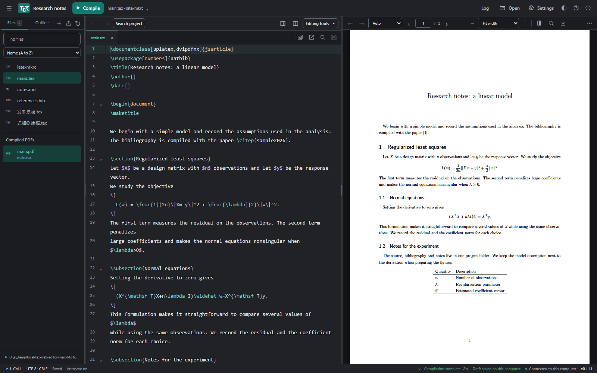
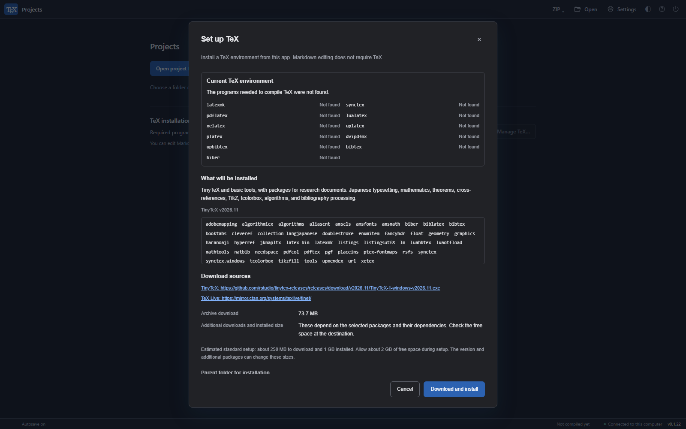
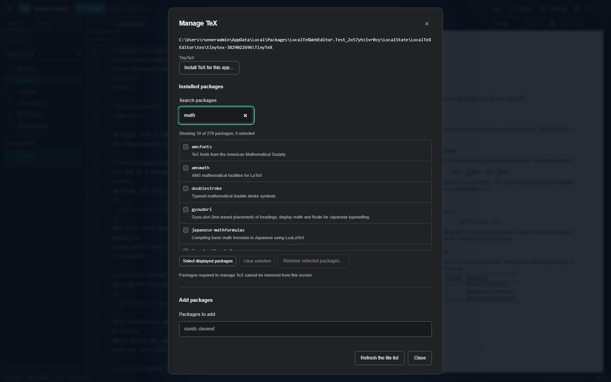
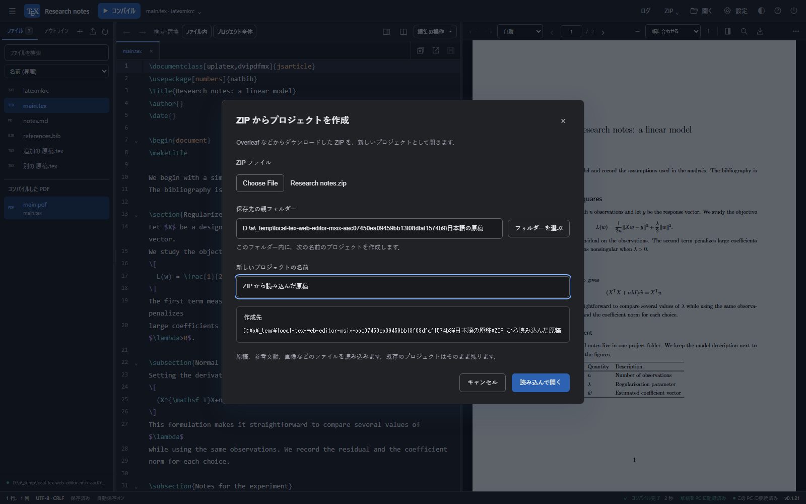
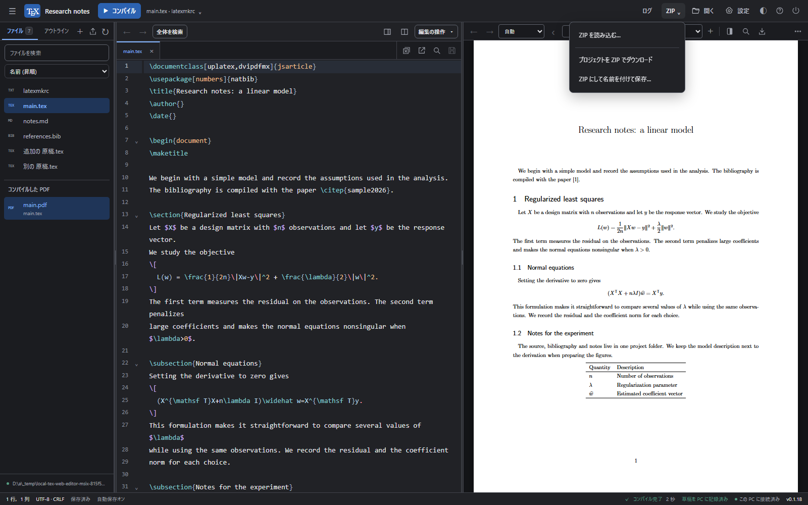
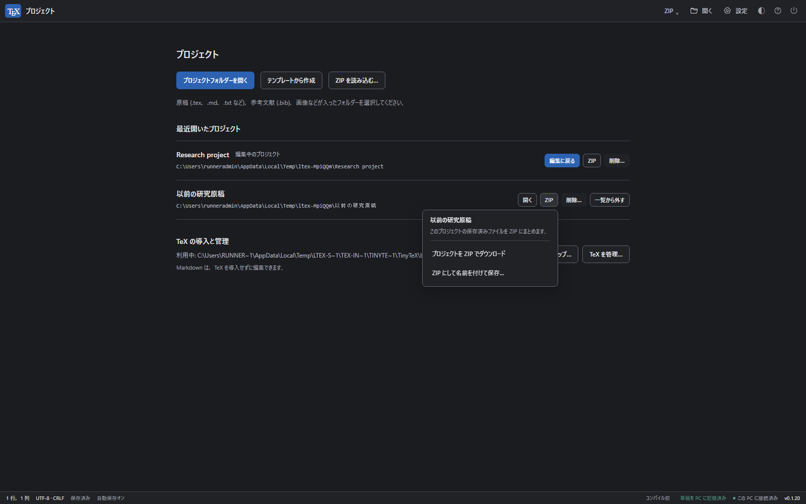
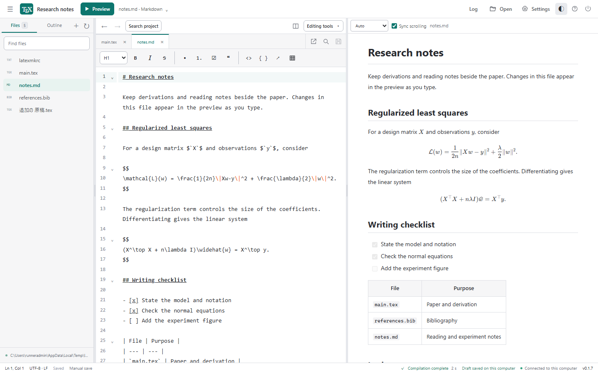

# Local TeX Web Editor

[English](README.md) | 日本語 · [紹介ページと使い方](https://kodai-utsunomiya-mdl.github.io/Local-TeX-Web-Editor/ja/)

[](https://apps.microsoft.com/detail/9P6QF32N19HG?hl=ja-jp&gl=JP)
&nbsp;&nbsp;
[](https://github.com/kodai-utsunomiya-mdl/Local-TeX-Web-Editor/releases/download/v0.1.22/local-tex-web-editor-0.1.22-windows-x64.zip)
&nbsp;&nbsp;
[](https://github.com/kodai-utsunomiya-mdl/Local-TeX-Web-Editor/releases/download/v0.1.22/local-tex-web-editor-0.1.22-macos-universal.zip)

**v0.1.22** · [配布ファイルと更新内容](https://github.com/kodai-utsunomiya-mdl/Local-TeX-Web-Editor/releases/latest) · [初めて使う](#初めて使う) · [起動する](#ダウンロードして起動する) · [利用前の準備](#利用前の準備) · [アプリの容量](#アプリとデータの保存先)

上のボタンから v0.1.22 の ZIP をダウンロードできる．Store 版は Microsoft Store から更新できる．

Windows と macOS のブラウザで TeX，Markdown，テキストの原稿を編集する **完全無料** のアプリ．アプリ内購入，有料アップグレード，サブスクリプション，試用期限はなく，すべての機能を使える．起動時には既定のブラウザで `localhost` の画面が開き，原稿と PDF を同じウィンドウで確認できる．



原稿は PC 上のフォルダーに保存する．アプリで選んだ TeX と原稿の `latexmkrc` を使い，コンパイル中のログと生成した PDF を画面へ表示する．利用する PC に追加の Python，Node.js，Go，VS Code を導入する必要はない．

## 作成した主な経緯

- **コンパイルの時間制限を気にせず書ける．** [Overleaf の無料枠にはコンパイル時間の上限がある](https://docs.overleaf.com/getting-started/free-and-premium-plans/plan-limits)．本アプリは PC の TeX を実行し，コンパイル時間の上限を設けていないため，長い原稿も手元の計算資源を使ってコンパイルを続けられる．必要なときは，エディタから処理を停止できる．

- **配布ファイルが小さく，軽量な構成で原稿を編集できる．** [VS Code のデスクトップ版は Electron を使う](https://code.visualstudio.com/docs/editor/whyvscode)．本アプリは Go の実行ファイルと普段のブラウザのタブで動作し，配布ファイルに専用のブラウザエンジンを含めない．TeX の補完，コンパイル，PDF の表示をアプリに備え，追加の拡張機能を入れずに使える．配布ファイルの実測容量は [アプリとデータの保存先](#アプリとデータの保存先) に記載している．

- **TeX もアプリから導入できる．** **ホーム → TeX をセットアップ…** から，必要な TeX のプログラムとパッケージをダウンロードして導入できる．完了すると環境が自動で選ばれ，サンプルの作成とコンパイルへ進める．既存の TeX を選んで使うこともできる．

- **Markdown やテキストの日常的な編集にも使える．** TeX を導入する前から，Markdown のメモや説明文，`.txt` ファイル，コード，設定ファイルを編集できる．Markdown では直接編集，ソースの編集，プレビューを使える．複数行の文章やコードをそのまま貼り付けて検索することもできる．

## 初めて使う

1. **アプリを入手して開く．** Windows では Microsoft Store または ZIP を選び，Mac では macOS 版をダウンロードする．下の [ダウンロードして起動する](#ダウンロードして起動する) に沿って進める．
2. **TeX を使う環境を選ぶ．** TeX が入っていない場合は，ホームの **Set up TeX… (TeX をセットアップ…)** から [導入の手順](#アプリから-tex-を導入する) へ進む．完了すると，導入した環境が自動で選ばれる．すでに TeX がある場合は，[既存の TeX を選ぶ](#既存の-tex-を選ぶ) の手順で設定する．
3. **サンプルを作る．** ホームの **Create from a template (テンプレートから作成)** を押し，**English article** または **Japanese document** を選ぶ．保存先のフォルダーと新しいプロジェクト名を指定し，**Create and open (作成して開く)** を押す．導入直後は，完了画面の **Create a sample… (サンプルを作成…)** からも同じ画面を開ける．
4. **コンパイルする．** `main.tex` を選んで **Compile (コンパイル)** を押すと，原稿の隣に PDF が表示される．

Markdown から始める場合は，**ホーム → Create from a template (テンプレートから作成)** で Markdown のテンプレートを選ぶと，TeX の導入前から編集できる．

## 利用前の準備

Windows または Mac と，現行の Chrome または Edge を使う．まずアプリを入手して起動し，ホーム画面から TeX の導入へ進む．Markdown の編集とプレビューは起動した時点から使える．

| 項目 | Windows | macOS |
| --- | --- | --- |
| OS と CPU | Windows 10 / 11，64-bit (x64) | macOS 12 Monterey 以降，Apple Silicon または Intel |
| ブラウザ | 現行の Chrome または Edge | 現行の Chrome または Edge |
| インターネット接続 | TeX とパッケージのダウンロード時に使う | TeX とパッケージのダウンロード時に使う |
| TeX 導入時の空き容量 | 作業中に約 2 GB | 作業中に約 2 GB |
| 原稿 | アプリでサンプルを作成，または既存のフォルダーを開く | アプリでサンプルを作成，または既存のフォルダーを開く |

Microsoft Store 版には，Windows 10 version 2004 (build 19041) 以降，または Windows 11 の x64 PC が必要である．

macOS 版の最低 OS は，アプリのビルドに使う [Go 1.25 の対応 OS](https://go.dev/doc/go1.25#darwin) に基づく．

## ダウンロードして起動する

### Windows

#### Microsoft Store

1. [Microsoft Store の Local TeX Web Editor](https://apps.microsoft.com/detail/9P6QF32N19HG?hl=ja-jp&gl=JP) を開き，無料のアプリをインストールする．
2. Windows のスタートメニューから **Local TeX Web Editor** を開く．既定のブラウザに編集画面が開く．
3. ホーム画面が開いたら，TeX がない場合は [アプリから TeX を導入する](#アプリから-tex-を導入する)，すでにある場合は [既存の TeX を選ぶ](#既存の-tex-を選ぶ) へ進む．続いてホームの **Create from a template (テンプレートから作成)** からサンプルを作れる．

インストールとアプリの更新は Microsoft Store が管理する．下の導入ガイドは，起動後のホーム画面から進められる．

#### ZIP をダウンロードする

1. [Releases](https://github.com/kodai-utsunomiya-mdl/Local-TeX-Web-Editor/releases) を開き，最新のバージョンを選ぶ．
2. **Assets** の `local-tex-web-editor-0.1.22-windows-x64.zip` をダウンロードする．`Source code` は開発用のソースである．
3. ZIP を展開し，`local-tex-web-editor.exe` をダブルクリックする．
4. 初回の起動時に，スタートメニューとデスクトップへショートカットが作成される．次回はそのショートカットから開ける．**設定 → 起動用のショートカット** からも作成できる．
5. ホーム画面が開いたら，TeX がない場合は [アプリから TeX を導入する](#アプリから-tex-を導入する)，すでにある場合は [既存の TeX を選ぶ](#既存の-tex-を選ぶ) へ進む．続いてホームの **Create from a template (テンプレートから作成)** からサンプルを作れる．

Windows の ZIP に含まれる実行ファイルにはコード署名が付いていない．GitHub のリリースから取得したファイルを開く際に SmartScreen の「Windows によって PC が保護されました」が出た場合は，「詳細情報」でアプリ名を確認し，「実行」を選ぶ．[Microsoft の案内](https://learn.microsoft.com/en-us/windows/apps/package-and-deploy/publish-first-app) も参照できる．

### macOS

1. [Releases](https://github.com/kodai-utsunomiya-mdl/Local-TeX-Web-Editor/releases) の **Assets** から `local-tex-web-editor-0.1.22-macos-universal.zip` をダウンロードする．Apple Silicon と Intel で共通の ZIP を使う．
2. ZIP を展開し，`Local TeX Web Editor.app` を「アプリケーション」フォルダーへ移す．
3. Finder や Spotlight から `Local TeX Web Editor` を開く．ブラウザに編集画面が開く．
4. ホーム画面が開いたら，TeX がない場合は [アプリから TeX を導入する](#アプリから-tex-を導入する)，すでにある場合は [既存の TeX を選ぶ](#既存の-tex-を選ぶ) へ進む．続いてホームの **Create from a template (テンプレートから作成)** からサンプルを作れる．

macOS 版には Apple Developer ID による署名と notarization が付いていない．初回に開けない場合は，このリポジトリの Release から取得したアプリであることを確認したうえで，macOS の「システム設定 → プライバシーとセキュリティ → このまま開く」を使う．手順は [Apple の公式案内](https://support.apple.com/ja-jp/102445) にある．

## アプリから TeX を導入する

まず [アプリをダウンロードして起動する](#ダウンロードして起動する)．初回は **英語** と **ダークモード** で表示される．日本語へ切り替える場合は，右上の **Settings** を開き，**Language / 言語設定** で **日本語** を選んで **Save and apply settings (設定を保存して反映)** を押す．配色は **Settings → Appearance (設定 → 外観)** で変更できる．導入の各画面は，英語でも日本語でも同じ操作で進められる．

| 初回の英語表示 | 日本語に切り替えた後の表示 |
| --- | --- |
| Set up TeX… | TeX をセットアップ… |
| Manage TeX… | TeX を管理… |
| What will be installed | インストールするもの |
| Download sources | ダウンロードの取得元 |
| Parent folder for installation | インストール先の親フォルダー |
| Browse… | 参照… |
| Download and install | ダウンロードしてインストール |
| Close and continue editing | 閉じて編集を続ける |
| TeX setup is complete. | TeX のセットアップが完了しました． |
| Create a sample… | サンプルを作成… |
| Create from a template | テンプレートから作成 |
| Destination folder | 保存先のフォルダー |
| Choose a folder | フォルダーを選ぶ |
| New project folder name | 新しいプロジェクトのフォルダー名 |
| Create and open | 作成して開く |
| Compile | コンパイル / コンパイルする |

### 1. ホームからセットアップを開く

ホームの **Projects (プロジェクト)** 画面で，「最近開いたプロジェクト」の上にある **TeX installation and management (TeX の導入と管理)** の **Set up TeX… (TeX をセットアップ…)** を押す．編集画面からホームへ戻るには，左上の TeX のロゴを押す．ホームと設定には，セットアップと管理の両方のボタンが常に表示される．セットアップは新しい環境の導入，管理は選択中の環境の操作に使う．**Manage TeX… (TeX を管理…)** は，TeX の環境が見つかると利用できる．


### 2. 導入するプログラムとパッケージを確認する

セットアップ画面の上部には，**Current TeX environment (現在の TeX)** と **What will be installed (インストールするもの)** がある．TeX がない PC では，プログラムの一覧に **Not found (見つかりません)** と表示される．その下の TinyTeX の版と，追加するパッケージの一覧を確認する．既存の TeX を使っている場合は，別のフォルダーへ新しく導入し，完了後にこのアプリで選択することが示される．既存の環境を使う場合は，[既存の TeX を選ぶ](#既存の-tex-を選ぶ) を参照する．



初期構成には pdfLaTeX，upLaTeX，XeLaTeX，LuaLaTeX，`latexmk`，SyncTeX，`dvipdfmx`，日本語の文書クラスと原ノ味フォント，BibTeX，upBibTeX，Biber，`upmendex` が含まれる．数式，図，定理などには，`amsmath`，`mathtools`，`mathrsfs`，`dsfont`，TikZ，`tcolorbox` の `most` ライブラリ，`algorithm`，`algpseudocode`，`hyperref`，`pxjahyper`，`cleveref` などを追加する．

### 3. 取得元，空き容量，導入先を確認する

セットアップ画面の中を下へスクロールし，**Download sources (ダウンロードの取得元)** を確認する．公式の [TinyTeX v2026.11](https://github.com/rstudio/tinytex-releases/releases/tag/v2026.11) を使い，ダウンロードした配布物の SHA-256 を照合してから展開する．追加の TeX Live パッケージの取得元も画面に表示する．

アーカイブの容量と，追加のダウンロードや展開後に必要な容量を確認する．標準構成の目安は **Windows で約 250 MB，Mac で約 300 MB のダウンロード**，**導入先に約 1 GB**，**作業中に約 2 GB の空き容量** である．取得する版や追加パッケージによって増減する．

**Parent folder for installation (インストール先の親フォルダー)** は，表示された推奨の場所を使うか，**Browse… (参照…)** から自分が書き込める別のフォルダーを選ぶ．選んだ親フォルダーの中に，このアプリ用の TeX のフォルダーを作る．空欄のまま開始すると推奨の場所を使う．既定の保存先は [アプリとデータの保存先](#アプリとデータの保存先) に記載している．


### 4. 導入を開始して進捗を確認する

内容と保存先を確認したら，**Download and install (ダウンロードしてインストール)** を押す．この段階ではインターネット接続を使う．ダウンロード中は，取得済みの量と全体の容量，進捗のバーを表示する．展開，パッケージの追加，動作の確認では，現在の段階と処理中を示すバーを表示する．**Setup log (セットアップのログ)** を開くと，処理中の出力を読める．


**Close and continue editing (閉じて編集を続ける)** を押すと，導入を続けながら Markdown を編集・保存できる．画面下部の表示，またはホームや設定の **View setup progress (セットアップの進捗を見る)** から進捗へ戻れる．**Stop setup (セットアップを停止)** で処理を止められる．失敗または停止した場合は，**Review and try again… (内容を確認して再試行…)** で内容と導入先を確認して再試行できる．

Windows x64 と，Apple Silicon / Intel の Mac に対応する．通常のユーザー権限で，自分のユーザーフォルダーへ導入する．取得するのは TeX のプログラムとパッケージで，プロジェクトの原稿は PC 内で扱う．[プライバシーポリシー](docs/privacy.ja.md) も参照できる．

### 5. 完了の表示を確認する

**TeX setup is complete. (TeX のセットアップが完了しました．)** と表示され，利用できるプログラムの確認が終わるまで待つ．完了後は導入した環境をアプリが選択し，そのままコンパイルできる．「現在の TeX」と保存先の表示で，選択された場所を確認できる．


プロジェクトを開かずにホームから開始した場合は，**Create a sample… (サンプルを作成…)** を押し，**Start from a template (テンプレートから始める)** を開く．ホームの **Create from a template (テンプレートから作成)** でも同じ画面を開ける．原稿を開いていた場合は，**Close (閉じる)** を押して編集へ戻る．完了画面に **Compile (コンパイルする)** が表示され，準備していた原稿が引き続き選択されている場合は，そこからコンパイルを開始できる．

### 6. 原稿を開いてコンパイルする

最初の原稿を作る場合は，テンプレートの一覧で **Japanese document (日本語の文書)** または **English article (英語の文書)** を選ぶ．**Destination folder (保存先のフォルダー)** の横にある **Choose a folder (フォルダーを選ぶ)** を押し，「ドキュメント」などの親フォルダーを選ぶ．**New project folder name (新しいプロジェクトのフォルダー名)** に `my-first-paper` など，まだ使っていない名前を入力し，**Create and open (作成して開く)** を押す．アプリがその親フォルダー内にプロジェクトを作り，テンプレートに合うコンパイラーを選ぶ．ファイル一覧の `main.tex` を開く．

既存の原稿を使う場合は，ホームの **Open project folder (プロジェクトフォルダーを開く)** を押し，**Browse… (参照…)** またはパスの入力でフォルダーを選んで **Open (開く)** を押す．ファイル一覧からメインの `.tex` を開き，「コンパイル」を押す．アプリが原稿に近い `latexmkrc` を使う．設定ファイルがなく，pdfLaTeX 以外のエンジンを使いたい場合は，**設定 → コンパイラー** でエンジンを選んで保存する．

上部の **Compile (コンパイル)** を押すと，原稿を保存してから TeX を実行する．完了すると，原稿の隣に PDF が表示される．パッケージがないというエラーが出た場合は，[TeX のパッケージと環境を管理する](#tex-のパッケージと環境を管理する) の手順で追加してから，もう一度コンパイルする．


## TeX の環境とパッケージ

### TeX に必要なプログラム

| プログラム | 用途 |
| --- | --- |
| `latexmk` | 原稿のコンパイルと，引用・相互参照のための再実行 |
| `pdflatex`，`uplatex`，`xelatex`，`lualatex` など | 原稿とコンパイラーの設定に合う TeX の実行 |
| `synctex` | PDF と原稿の対応する位置へ移動する操作 |
| `bibtex`，`upbibtex`，`biber` など | 原稿で採用している方法による参考文献の処理 |
| 原稿が使うパッケージとフォント | `\usepackage`，文書クラス，日本語フォントなどの読み込み |

upLaTeX の原稿では通常 `uplatex` と `dvipdfmx` を使い，参考文献の設定に応じて `upbibtex` なども使う．プロジェクトにある `latexmkrc` / `.latexmkrc` を一緒に用意する．

### 既存の TeX を選ぶ

TeX Live，BasicTeX，MacTeX，TinyTeX などで原稿をコンパイルできている場合は，**設定** の **TeX Live の bin フォルダー** に，その環境の場所を入力する．Windows の例は `C:\texlive\2026\bin\windows`，Mac の例は `/Library/TeX/texbin` である．**設定を保存して反映** を押すと，その環境を使う．

小さい構成から始めて，後で原稿に必要なものを追加できる．**設定 → TeX パッケージを追加** には，**latexmk と SyncTeX**，**日本語の組版** の選択肢がある．日本語の選択肢にある `collection-langjapanese` には，日本語のエンジン，文書クラス，フォントと，それらが使うパッケージが含まれる．数式，図，文献処理などのパッケージは名前を入力して追加できる．

### TeX のパッケージと環境を管理する

ホームまたは設定の **「TeX を管理…」** で，選択中の環境とパッケージの一覧を開く．導入後も，セットアップと管理の両方のボタンを表示する．一覧を検索し，パッケージ名を入力して **「追加する内容を確認…」** へ進める．導入済みの項目を選んで **「選んだパッケージを削除…」** を押すと，`tlmgr` が示す削除予定と依存関係を確認できる．**「表示したパッケージを削除」** で実行する．TeX の管理に必要なパッケージは一覧から削除できない．

アプリから導入した TeX と，既存の TeX Live，MacTeX，TinyTeX に対応する．既存の環境には，そのパッケージ管理に設定された取得先を使う．`tlmgr` が CTAN との年度の不一致を報告した場合は，その TeX Live の年度の `tlnet-final` へ再試行し，保存された取得先の設定はそのまま使う．独自・ローカル・複数の取得先は，その設定で実行する．Windows の ZIP 版と Mac では，変更に管理者権限が必要な場合に OS の承認画面を開く．Microsoft Store 版で共用の環境を変更する場合は，公式の `tlshell` が導入済みなら **「TeX の管理ツールを開く」** から移り，そのツールの承認と操作で進める．



管理画面で TeX の実際の保存先とパッケージを確認できる．`math` などで一覧を絞り込み，パッケージを追加する欄も同じ画面で使える．

**「TeX の環境全体を削除…」** は，保存先，項目数，容量，他のアプリへの影響を示す確認画面を開く．アプリから削除を開始する場合は，内容を確認し，チェックと表示されたフォルダー名の入力で進める．アプリから導入した TeX は，記録した導入先から削除する．既存の Windows の TeX Live は公式アンインストーラーを使い，既存の Mac の TeX とユーザー所有の TinyTeX は OS のごみ箱へ移す．Windows でごみ箱を使えない場合は，完全な削除の前に OS が確認する．管理者権限が必要な環境を Store 版で使う場合は，**「Windows の設定でアンインストール…」** から Windows 側で削除を選ぶ．設定画面を開くだけならフォルダー名の入力は不要となる．公式アンインストーラーが設定などのファイルを残した場合は，その場所をログに表示する．同じ TeX を使う他のアプリでも，再導入やごみ箱からの復元を行うまで，その環境を使えなくなる．

設定からパッケージを追加する手順は，次の通りである．

1. **TeX パッケージを追加** を展開する．
2. **latexmk と SyncTeX** または **日本語の組版** を選ぶか，**追加するパッケージ** に名前をスペースで区切って入力する．
3. 導入済みとして表示されるのにファイルがない場合は，**ファイルが欠けている場合は，同じパッケージを再取得する** にチェックを入れる．
4. **追加する内容を確認…** を押し，次の画面でパッケージの一覧，取得元，**追加先** のフォルダーを確認する．
5. **確認したパッケージを追加** を押し，完了したら原稿を再コンパイルする．

管理画面からの追加も，同じ確認と進捗の画面を使う．Store 版から直接変更できない共用の環境では，表示された **TeX の管理ツールを開く** から操作し，完了後にアプリへ戻って **パッケージ一覧を更新** を押す．

例えば `File 'siunitx.sty' not found` と表示された場合は，パッケージ名 `siunitx` を入力して追加する．名前が分からない場合は，原稿の案内やパッケージの説明を確認する．ファイル名とパッケージ名が異なる場合もある．配布元や著者から渡された独自の `.sty` や `.cls` は，プロジェクトのフォルダーへ置く．原稿と PDF の移動については，[SyncTeX を追加する](#synctex-を追加する) を参照できる．

### 導入済みの TeX を確認する

**設定** で，選択中の **TeX Live の bin フォルダー** とプログラムの利用状況を確認する．**TeX をセットアップ… → 環境を再確認** で，プログラムの確認をやり直せる．**TeX を管理…** には，実際の導入先と導入済みのパッケージを表示する．

必要なプログラムがない場合は，**TeX パッケージを追加** で内容を確認して追加する．原稿と PDF の移動に SyncTeX が必要な場合は，専用の **SyncTeX を追加…** ボタンから進める．追加後に原稿を再コンパイルし，現在の原稿に対応する PDF と SyncTeX のデータを作成する．

## プロジェクトとアプリの更新

### プロジェクトを開き，作業を終了する

PC にある原稿は，`.tex`，`.md`，`.txt`，`.bib`，画像，`latexmkrc` などを含むプロジェクトのフォルダーを指定して開く．Overleaf などからダウンロードしたプロジェクトの ZIP は，ホームの **ZIP を読み込む…** から開ける．

ブラウザの編集タブが休止したり閉じられたりしても，アプリは動作を続ける．タブへ戻ると同じローカルアドレスへ接続し直す．同じ版のアプリをもう一度起動した場合も，起動中の編集画面を開く．ページから離れる際には草稿とタブの位置を記録し，戻ったときに読み込む．原稿に未保存の編集がある場合は，ブラウザの確認画面が出る．

右上の終了ボタンで，アプリとコンパイル中の処理を終了する．未保存の編集がある場合は，保存するか草稿に残すかを選べる．ブラウザが自動で閉じる操作を認めない場合は，終了したことを画面に表示するので，Windows では `Ctrl + W`，Mac では `Cmd + W` でタブを閉じる．

### ZIP からプロジェクトを読み込む

1. ホームの **Import ZIP… (ZIP を読み込む…)** を押す．編集画面では，**ZIP → Import ZIP… (ZIP を読み込む…)** を選ぶ．
2. **ZIP file (ZIP ファイル)** でプロジェクトの `.zip` ファイルを選ぶ．
3. **Destination parent folder (保存先の親フォルダー)** にパスを入力するか，**Choose a folder (フォルダーを選ぶ)** で選ぶ．**New project name (新しいプロジェクトの名前)** には，まだ使っていない名前を入力する．ZIP の名前をもとにプロジェクト名を提案する．
4. **New project folder (作成先)** を確認して **Import and open (読み込んで開く)** を押す．その新しいフォルダーへ原稿，参考文献，画像などを展開し，プロジェクトを開く．

[](docs/screenshots/project-zip-import-ja.png)

同じ名前のフォルダーがある場合は，新しい名前を指定する．ZIP 内にある日本語のファイル名や，画像・章ごとのフォルダー構成も使える．Overleaf でダウンロードしたソースの ZIP を，アプリで展開して編集できる．

### プロジェクトを ZIP でダウンロードする

1. プロジェクトを開き，上部の **ZIP → Download project as ZIP (プロジェクトを ZIP でダウンロード)** を選ぶ．編集中の原稿を保存してから，プロジェクトの ZIP を作る．
2. ブラウザのダウンロード設定に従い，`<プロジェクト名>.zip` を保存する．
3. 任意の保存先とファイル名を選ぶ場合は，**ZIP → Save project ZIP as… (ZIP にして名前を付けて保存…)** を選ぶ．Windows または Mac の保存画面でフォルダーと `.zip` で終わるファイル名を指定し，**保存** を押す．同名のファイルがある場合は，上書きの確認が表示される．どちらの操作もファイル一覧の右クリックメニューから使える．

[](docs/screenshots/project-zip-menu-ja.png)

ホームの最近開いたプロジェクトでも，各プロジェクトの **ZIP** から両方の書き出しを選べる．編集中のプロジェクトでは，開いている原稿を保存してから ZIP を作る．別のプロジェクトでは，そのフォルダーに保存されたファイルを使う．書き出した後も，現在のプロジェクトで編集を続けられる．

[](docs/screenshots/project-home-zip-ja.png)

Overleaf で使う場合は，**New project → Existing project (.zip)** でこの ZIP を選ぶ．メイン文書とコンパイラーを，元のプロジェクトに合わせて選ぶ．手順は Overleaf の [Uploading a project](https://docs.overleaf.com/managing-projects-and-files/uploading-a-project) で確認できる．

ZIP の直下に原稿と各フォルダーを置き，参考文献，画像，フォント，独自の `.sty`・`.cls`，`latexmkrc` などもまとめる．アプリのキャッシュ，Git の管理用フォルダー，コンパイルに対応するログや中間ファイルは含めない．図として使う PDF，外部の文書を参照する `.aux`，参考文献の `.bbl`，独自の `.ist` は ZIP に含める．

### PC の再起動後にブラウザのタブから戻る

**ログイン時の起動は初期状態で有効** である．アプリは PC 内の接続先を記録し，ログイン後にバックグラウンドで起動するため，復元したブラウザのタブから接続できる．

1. **設定 → ログイン時の起動** を開く．
2. オフにする場合は **無効にする**，再びオンにする場合は **ログイン時の起動を有効にする** を押す．必要な場合は **OS の起動設定を開く…** から確認できる．
3. PC を再起動した後，ブラウザで前回のタブを復元する．プロジェクトと記録済みのタブ・編集位置へ戻る．ブラウザが先に起動した場合は，待機画面からアプリへ自動的に再接続する．

この設定では，ログイン時にアプリをバックグラウンドで起動し，新しいブラウザのタブは開かない．**無効にする** で次回以降の自動起動を止められる．**終了** は現在動いているアプリを停止し，アプリを開くと再び起動する．自動起動を使わず，自分でアプリを起動してから復元したタブへ戻る方法も使える．

v0.1.14 以前から更新した場合は，新版のアプリを一度開き，そのときに開いたタブを次回から復元する．旧版のタブには，以前の一時的な接続先が記録されている．記録した接続先を他のアプリが使っている場合は，空いている接続先で開き，使用するタブを画面に案内する．

### 更新する

**アプリの自動更新は初期状態で有効** である．起動後に更新を確認し，新しい版をバックグラウンドで取得する．編集中の原稿の保存，コンパイル，TeX の操作が済み，開いている全ての編集画面で操作が落ち着いてから更新して再起動する．再起動後は，同じブラウザタブで編集を再開できる．

更新の通知にある **1 時間後に更新** で適用を延期できる．**設定 → アプリの更新** には，自動更新の設定，**今すぐ確認**，**保存して更新・再起動**，更新内容へのリンクがある．自動更新を無効にした場合も，**今すぐ確認** から更新を取得できる．

**Microsoft Store 版** は，Store から利用可能になった更新を取得する．Windows の自動更新設定や通信条件に従って進み，Store の審査と公開が完了した版へ更新する．**Windows の ZIP 版** は，署名を確認した更新ファイルを取得し，起動中の実行ファイルを入れ替える．新しい版の起動に失敗した場合は元の実行ファイルへ戻す．**macOS 版** は，アプリに同梱した Sparkle で署名を確認し，アプリケーションを更新する．

v0.1.16 以前の ZIP 版からは，自動更新を備えた版を最初に一度導入する．Windows では新しい ZIP を展開して `.exe` を起動し，原稿を保存して旧版を終了する．Mac ではアプリを終了し，新しい `Local TeX Web Editor.app` を「アプリケーション」にある旧版と置き換えて開く．その後の更新はアプリが確認する．設定画面の **アプリのバージョン** と **起動中の実行ファイル** で，動いているアプリを確認できる．

同じバージョンのアプリをもう一度開くと，既存の編集画面へ接続する．同じ原稿を複数のプロセスが同時にコンパイルすることを防ぐ仕組みも入れている．

### スタートメニューやデスクトップから開く (Windows)

**Microsoft Store 版** は，インストール後にスタートメニューから開ける．

**ZIP 版** では，アプリからショートカットを作成できる．

1. アプリの「設定」を開く．
2. 「起動用のショートカット」で「スタートメニューに追加」または「デスクトップに作成」を押す．
3. 次回から，スタートメニューで `Local TeX Web Editor` を探すか，デスクトップのショートカットを開く．ブラウザに編集画面が開く．

この操作で，アプリを `%LOCALAPPDATA%\Programs\LocalTeXEditor\local-tex-web-editor.exe` に配置する．ダウンロード時のフォルダーを移動しても，ショートカットから起動できる．ZIP 版の各コピーは，設定と草稿を共通の場所から読み込む．

実行ファイル，ショートカット，ブラウザのタブには，青の背景に白い TeX の専用アイコンを使う．

新しい ZIP の `.exe` を起動すると，配置済みのアプリと，スタートメニューやデスクトップに作成済みのショートカットが更新される．次回も同じショートカットから新版を起動できる．

## 原稿を編集する

初回の表示言語は English である．**Settings → Language / 言語設定** で **English** または **日本語** を選ぶと，その場で画面の言語が切り替わる．「設定を保存して反映」で次回の起動にも反映し，「キャンセル」または `Esc` で保存済みの言語へ戻る．項目名は常に日英を併記する．原稿，PDF，Markdown の本文は入力した内容を表示する．

左側のファイル一覧から `.tex`，`.bib`，Markdown，Python，JavaScript などのテキストファイルを開く．複数のファイルはタブで切り替えられ，ドラッグで並べ替えられる．長いタブ欄はホイール，トラックパッド，タッチで横へスクロールできる．原稿の上の「すべてのタブを閉じる」では，未保存の本文があれば保存・破棄・キャンセルを選べる．次回の起動時には，タブと並び順を読み戻す．すべて閉じた場合は空のタブ欄で再開する．設定ではエディタの文字サイズを 8〜40 px に変更できる (既定は 14 px)．文字サイズの選択は，次回の起動でも同じになる．

ファイル一覧・アウトラインの右端，原稿とプレビューの境界，ログの上端をドラッグして，幅や高さを変えられる．`Tab` キーで境界へフォーカスを移した後は，左右または上下の矢印キーでも調整できる．境界をダブルクリックすると，その境界が初期位置に戻る．変更した大きさは次回の起動にも反映され，ウィンドウを小さくすると画面に収まる範囲へ調整される．

フォルダーは左側の一覧で展開できる．画像や PDF を選ぶと，原稿と同じタブ欄でプレビューを開く．原稿のタブへ戻ると，編集中の内容とカーソルの位置から作業を続けられる．

文字を選択すると，選択範囲に背景色が付く．ライト／ダークの両方で，現在の行やエディタからフォーカスを移した後の範囲も確認できる．

| 操作 | 使い方 |
| --- | --- |
| ファイルや見出しを探す | 左側の検索欄を使う．「アウトライン」で編集中のファイルの見出しを表示する．分割した TeX 原稿では「文書全体」を選ぶと読み込み先の見出しも表示する．見出しをクリックすると，上側に余白を設けて原稿の該当行を表示する |
| 引用を入力する | `\citep{` や `\cite{` の中で，プロジェクト内の `.bib` にあるキーが候補になる．著者・年・題名も確認できる |
| 相互参照を入力する | `\ref{`，`\eqref{`，`\cref{` などの中で，原稿の `\label` が候補になる |
| 補完を呼び出す | TeX のコマンドを入力する，または `Ctrl + Space` を押す．補完した引数の間は `Tab` / `Shift + Tab` で移動できる |
| 原稿を折りたたむ | 行番号の横にある矢印で，セクション，環境，Markdown の見出しやコードブロックを折りたたむ，または展開する |
| 原稿を検索・置換する | エディタで `Ctrl + F` を押す，または「検索・置換」の「ファイル内」を押す．複数行をそのまま貼り付けられる |
| プロジェクト全体を検索する | 「検索・置換」の「プロジェクト全体」または `Ctrl + Shift + F` を使う．結果を確認し，置換する箇所を選べる |
| 参照先から元の場所へ戻る | 原稿や PDF の上にある `←` / `→`，または `Alt + 左矢印` / `Alt + 右矢印` を使う |
| 原稿を二つ並べる | 「原稿を二つ並べる」を押し，各エディタの上で表示する原稿を選ぶ |
| 以前の原稿と見比べる | 「編集の操作 → 編集履歴を開く」を選ぶ |
| 引用や相互参照を確認する | 「編集の操作 → 引用・参照を確認」で，定義や使用箇所を開く |
| 画像や表を挿入する | 原稿で右クリックするか，「編集の操作 → 画像を挿入」または「表を挿入」を使う |
| 原稿の文字を拡大・縮小する | ソース編集と Markdown の直接編集で，`Ctrl + ホイール`，タッチパッドのピンチ，またはタッチ画面の 2 本指のピンチを使う．両ペインと設定の文字サイズに反映し，次回の起動にも使う |
| ファイルを保存する | `Ctrl + S` を押す．開いているファイルをすべて保存する操作は `Ctrl + Shift + S` |
| コンパイルする | `Ctrl + Enter`，または「コンパイル」を押す．ファイルを保存してから，編集対象の TeX 文書をコンパイルする |
| エラーや警告を確認する | 「ログ」を開いて種類を選び，ファイル名と行番号がある項目をクリックして原稿へ移動する |

Mac では，保存・検索・コンパイル・SyncTeX のクリック操作に使う `Ctrl` を `Cmd` に読み替える．原稿の文字サイズは `Ctrl + ホイール`，`Cmd + ホイール`，トラックパッドのピンチで変更できる．

検索欄と置換欄では，改行と TeX の `\` を入力どおりに扱う．`Enter` で次の一致箇所へ，`Shift + Enter` で前へ移動する．欄の中で改行を入力するには `Ctrl + Enter` を使う．正規表現は検索欄のチェックボックスから有効にできる．検索欄は **×** ボタンで閉じられ，欄にフォーカスがある状態では `Esc` でも閉じられる．

文字サイズやテーマの変更は，原稿の内容とコンパイル済みの PDF に影響しない．PDF の更新案内は，原稿またはコンパイルの設定に変更がある場合に表示される．

### ファイルを操作し，プログラムを編集する

**TeX のロゴ**を押すとホームが開き，現在のプロジェクトと最近開いたプロジェクトを管理できる．「編集に戻る」で，未保存の本文，タブ，カーソル位置がある同じ編集画面へ戻る．一覧にはプロジェクト名とフォルダーの絶対パスを表示し，各プロジェクトの **ZIP** から書き出しを選べる．

ホームを開いたときやブラウザの画面へ戻ったときに，フォルダーの状態を読み直す．移動・削除された場合や読み取れない場合は，そのプロジェクトに理由を表示する．ドライブの再接続やフォルダーを戻した後には「再確認」を使い，移動先を使う場合はフォルダーを選び直す．「一覧から外す」は最近の一覧の登録を外す操作で，PC 上の原稿，設定，草稿は残る．現在のフォルダーが使えない間も，開いた本文の編集と草稿の記録を続けられ，元の場所が使える状態に戻ると保存やコンパイルを再開できる．保存された PDF のプレビューも引き続き読める．

各プロジェクトの「削除…」では，隠し項目や記録した草稿を含めて，削除するファイルとフォルダーを確認できる．確認のチェックを入れ，プロジェクト名を正確に入力して「プロジェクトを削除」を押すと，PC 上のフォルダーを中身ごと削除する．確認後にファイルや草稿が変わった場合は一覧を更新し，もう一度確認する．対象の草稿と，最近使ったプロジェクトの登録も削除する．

ファイル，フォルダー，ファイル一覧の空いている部分を右クリックすると，その場所へ新規ファイルやフォルダーを作成できる．「コンピューターからファイルを追加…」では，ファイル選択画面から選んだファイルをプロジェクトへコピーする．「＋」の隣のボタンからも開ける．コピー先のフォルダーを選び，同名のファイルがある場合は「置き換える」「別名で追加」「スキップ」から選ぶ．開いているタブや草稿があるファイルを置き換える場合は，先にタブを閉じるか草稿を確認する．複数のファイルを選べ，1 ファイルの上限は **128 MiB** である．「＋」からプロジェクト内のパスを指定して新しいファイルを作る方法も使える．

右クリックメニューでは，相対パス・絶対パスのコピー，名前の変更，「削除…」も選べる．項目にフォーカスして `Shift + F10` またはメニューキーを押しても開く．矢印キーで操作を選び，`F2` で名前の変更，`Delete` で削除の確認画面へ進める．フォルダーの確認画面には中身と未保存の原稿が表示され，フォルダーを中身ごと削除できる．名前を変えると，開いているタブと編集中の本文も新しいパスへ移る．別の原稿に書いたリンクや参照先は必要に応じて書き換える．

ファイルの右クリックでは **「ダウンロード」** と **「名前を付けて保存…」** を選べる．「ダウンロード」はブラウザのダウンロード設定に従ってコピーを保存する．「名前を付けて保存…」は Windows または Mac の保存画面を開き，PC 上の任意のフォルダーとファイル名を選べる．同名のファイルがあれば上書きを確認する．編集中のファイルでは，どちらの操作も未保存の変更を含む現在の本文を使う．別の場所へコピーを保存した後も，元のタブで編集を続けられる．「名前を付けて保存…」で元のファイルを選ぶと，通常の保存と同じ外部変更の確認と編集履歴の記録を行う．画像，PDF，そのほかのファイルにも使える．

「コピーを作成…」では，ファイルやフォルダーをプロジェクト内へコピーできる．コピー先のパスと未保存の編集があるファイルを確認してから作成する．コピーにはディスクへ保存済みの内容を使い，元のタブでは未保存の本文を引き続き編集できる．コピー先に同じ名前がある場合は，別の名前や場所を選ぶ．

新規ファイルの画面では，空のファイルか，標準・ユーザーのテンプレートを選べる．複数のファイルがあるテンプレートでは，テキストファイルを 1 個選び，内容をプレビューしてから新しいファイルを作る．右クリックしたフォルダーを最初の作成先とし，作成前にプロジェクト内のパスを変更できる．

「ファイルを検索」の下にある並び順の選択欄で，名前の昇順・降順，更新日時の新しい順・古い順，手動の順序を選べる．名前や日時で並べる場合は各階層でフォルダーを先に表示し，検索中も選んだ順序を使う．更新日時は，それぞれのファイルやフォルダーについて OS が記録した時刻である．保存した直後に順序へ反映し，ファイル一覧の更新やタブへ戻ったときにも，他のアプリでの変更を読み取る．選んだ並び順は次回の起動時にも使える．

項目をほかの項目の間へドラッグすると，「手動の並び順」に切り替わり，その場所へ並べ替える．項目にフォーカスして `Alt + 上矢印` / `Alt + 下矢印` で順序を変えることもできる．フォルダーの中央へドロップすると，そのフォルダーへ移動する．移動後も開いているタブと未保存の本文を編集でき，同名の項目が移動先にある場合は操作を止める．並び順の選択欄から，名前や日時の順序へ戻せる．

プログラムや設定ファイルでも，保存，検索，草稿，履歴を使える．Python，JavaScript/TypeScript，C/C++，Java，Kotlin，C#，Go，Rust，R，Ruby，shell，PowerShell，HTML，CSS，XML，SQL，JSON，YAML，TOML，Lua などを色付けして表示する．そのほかの対応形式はプレーンテキストで開く．`.ipynb` は JSON のテキストとして編集する．プログラムの実行には別途それぞれの実行環境を使う．

### TeX を補完し，アウトラインを使う

`\b` を入力すると `\begin` が候補になり，選ぶと `\begin{}` の中へカーソルが移る．そこで `i` を入力して `itemize` を選ぶと，`\item` の本文と `\end{itemize}` まで補完する．見出し，文字の装飾，引用，相互参照，図，表，数式のコマンドも使える．例えば `\frac` では分子と分母の欄を作り，`Tab` / `Shift + Tab` で引数の間を移動できる．現在の原稿で `\newtheorem` や `\newenvironment` によって定義した環境も候補になる．

文献の詳細は候補一覧の横，狭いエディタでは下に表示し，詳細だけをスクロールできる．「設定」の「TeX の入力補完を使う」で補完をオン・オフにできる．「入力中に候補を自動で表示する」をオフにした場合も，`Ctrl + Space` で候補を開ける．

アウトラインの「文書全体」では，メイン原稿から `\input`・`\include` で読み込むファイルの見出しを本文順に表示する．見出しを選ぶと，そのファイルの該当行に移動する．「現在のファイル」では編集中の原稿の見出しを表示する．

アウトラインには見出しの階層を示す縦線と矢印がある．矢印を押すと下位の見出しを折りたたみ，見出しを押すと原稿の該当行へ移動する．原稿では行番号の横の矢印でセクションや環境を折りたためる．Markdown の見出しやコードブロックにも対応する．アウトライン，検索，PDF から移動する際は，折りたたまれた移動先を展開する．キー操作は「ヘルプ → キーボードショートカット」にある．

### プロジェクト全体の本文を検索・置換する

「検索・置換」の「プロジェクト全体」は，`.tex`，`.bib`，Markdown など，対応するテキストファイルの本文を調べる．未保存の原稿では，エディタで編集中の内容を使う．コンパイルで生成したファイルは対象外である．結果を選ぶと，原稿の該当箇所を開ける．

検索する前に「置換後の文字列」を入力すると，各箇所の変更前と変更後を確認できる．変更する箇所にチェックを入れるか，「すべて選択 / 解除」を使い，「選択した … 箇所を置換」を押す．置換したファイルは保存する．保存前にエディタとディスク上の本文を確認し，内容が変わっていた場合は検索し直してから進める．

複数行，大文字と小文字の区別，単語単位，正規表現に対応する．正規表現には RE2 を使い，置換後の文字列では `$1` や `${name}` でキャプチャした文字列を参照できる．検索結果は最大 1000 件で，「検索を中止」から処理を止められる．ファイルの大きさなどの上限に達した場合は案内を表示するので，検索する文字列を詳しく指定する．

### 原稿を二つ並べて開く

タブの上にある「原稿を二つ並べる」を押す．各エディタの上で表示する原稿を選べるので，別々の文書や，同じ原稿の異なる箇所を見ながら編集できる．カーソルとスクロール位置は，各表示で動かせる．同じ原稿の編集は両方の表示へ反映され，どちらからも Undo と Redo を使える．

境界をドラッグして，二つのエディタに使う幅を変更できる．狭い画面では上下に並ぶ．「二つ目のエディタを閉じる」を押すと一つの表示に戻る．次回そのプロジェクトを開くと，表示していた文書，操作中だったエディタ，各表示の位置，境界の大きさを読み戻す．

### 引用と相互参照を確認する

引用のキーやラベルにカーソルを置き，「編集の操作 → 引用・参照を確認」を開く．一覧ではキー，題名，著者でも検索できる．「定義」と「使用箇所」には本文の抜粋とリンクがあり，原稿の該当箇所へ移動できる．

キーを変更する場合は，「キーの名前を変更」で新しい名前を入力し，「変更内容を確認」を押す．対象となる行を見てから「確認した変更を適用」を選ぶ．標準的な引用・参照コマンドを対象とし，コメント，コード例，自作コマンドの定義はそのままになる．保存前にはファイルの内容をもう一度確認する．

### 編集履歴から原稿の一部を戻す

「編集の操作 → 編集履歴を開く」で以前の版を選び，現在の原稿と見比べながら戻したい箇所にチェックを入れる．複数の箇所を選べ，「変更箇所をすべて選択」や `Shift` を押しながらのクリックで範囲を選択する操作も使える．「選択した … 箇所を原稿へ戻す」でまとめてエディタへ反映し，Undo で取り消したり，続きを編集して保存したりできる．変更が大きい場合は，一つの変更として表示することがある．「現在の内容を記録」では，未保存の内容にも名前を付けて記録できる．版の名前は省略できる．

不要な版は，一覧のチェックボックスで複数選び，「選択した … 版を削除…」から名前と日時を確認して削除できる．版の一覧にも「すべての版を選択」と `Shift` を押しながらのクリックで範囲を選択する操作がある．削除の対象は選んだ履歴で，現在の原稿はそのまま残る．削除した履歴は元に戻せない．

編集履歴の記録は，初期状態でオンになっている．原稿を保存した際に変更前の本文を圧縮して記録し，同じファイルの自動記録には 1 分以上の間隔を設ける．同じ画面の「履歴の設定」で日数や合計容量を変更でき，「編集履歴を記録する」をオフにすると新しい版の記録を止める．

| 履歴の設定 | 初期値または上限 |
| --- | --- |
| 保存する期間 | 30 日．1〜365 日で変更できる |
| 圧縮した履歴の合計容量 | 50 MiB．5〜200 MiB で変更できる |
| 1 ファイルの版数 | 最大 50 版 |
| 全プロジェクトの版数 | 合計で最大 2000 版 |
| 原稿の大きさ | 1 版につき最大 2 MiB |

期間，容量，件数のいずれかの上限に達すると，名前を付けた版を含めて古いものから削除する．記録をオフにした後も，既存の版にはこれらの上限を適用する．履歴は「[アプリとデータの保存先](#アプリとデータの保存先)」にある，PC のアプリ用データフォルダーへ保存する．

### 画像や表を挿入する

クリップボードの画像を貼り付ける，原稿へファイルをドラッグする，または「編集の操作 → 画像を挿入」を開く．PNG・JPEG・PDF を **1 個につき 8 MiB** まで取り込める．プロジェクト内の保存先を選び，挿入する原稿を確認して進める．同じ名前のファイルがある場合は，新しいコピーの末尾に番号を付ける．TeX では図の説明，ラベル，幅を指定でき，`graphicx` を使う．Markdown では相対パスの画像を挿入し，PDF は通常のリンクとして挿入する．

「編集の操作 → 表を挿入」では，表計算ソフトからコピーした，タブまたはカンマで区切ったセルを貼り付けられる．「行数」と「列数」を指定して「新しい表を作る」こともできる．見本のセルを直接編集し，先頭行を見出しにするかを選び，挿入する TeX または Markdown の原稿を確認して進める．上限は 500 行，50 列，合計 10000 セルである．見本は先頭の 30 行・12 列を表示し，挿入する原稿には表全体が含まれる．

### テンプレートからプロジェクトを作る

最初の画面の「テンプレートから作成」，またはプロジェクトの「編集の操作 → テンプレートを管理」を開く．標準のテンプレートには，LuaLaTeX を使う日本語の文書，英語の文書，Beamer のスライド，Markdown のメモがある．テンプレート，保存先，新しいフォルダー名を選び，「作成して開く」を押す．

自分のテンプレートを追加する場合は，「現在のプロジェクトをテンプレートに追加する」を開き，名前と登録する原稿・画像を選ぶ．「保存してテンプレートに追加」を押すと，開いている原稿を保存して選んだファイルを登録する．生成した PDF，コンパイルの補助ファイル，編集履歴は含めない．1 個のテンプレートには最大 200 ファイル・合計 32 MiB を登録でき，自分のテンプレートは最大 20 個まで作れる．「選んだテンプレートを編集する」では名前と説明を変えたり，登録を削除したりできる．

### 外観を選ぶ

**設定 → 外観** では，モード (システム・ライト・ダーク)，7 種の配色 (グレー・ブラック・ブルーグレー・暖色・ネイビー・フォレスト・プラム)，8 色のアクセント，10 種の原稿のフォントを選べる．黒い背景で使うには，モードに「ダーク」，配色に「ブラック」を選ぶ．「システム」は PC のライト／ダーク設定に合わせる．選んだ外観の見本も画面で確認できる．

背景・文字・アクセントには，色の選択欄や 16 進数のカラーコードで色を指定できる．ライトとダークの色はそれぞれ保存する．コードを空にすると，選んだ配色の色へ戻る．設定画面，補完のポップアップ，通知，コンパイル結果，草稿の状態にも選んだ色を使う．

通知や浮動メニューは専用の背景色と枠，影で表示する．ライトとダークの配色に応じて文字色も調整し，カラーコードで指定した色にも対応する．

初回起動から **ダークモード** を使う．初期状態の配色は「グレー」，アクセントは「青」，原稿のフォントは「Consolas」である．グレーと Consolas は一覧の先頭に置き，初期値と表示する．以前に保存した外観がある場合は，その設定を読み込む．Consolas がない PC では，Cascadia Code，Menlo，DejaVu Sans Mono，ブラウザの等幅フォントの順に探して表示する．

変更はその場で表示に反映される．「外観を保存」を押すと，次回も選んだ外観で開く．「キャンセル」，`Esc`，**×** で閉じると，開く前の外観に戻る．「外観を初期値に戻す」では初期値の見本を確認し，「外観を保存」で確定する．

右上のテーマボタンでは，配色・アクセント・フォントの選択を使いながら，ライトとダークを直接切り替えられる．選んだフォントが PC にない場合は，標準の等幅フォントで原稿を表示する．

### ヘルプとフィードバック

右上の **? (ヘルプ)** ボタン，または `F1` でヘルプを開ける．使い方のサイト，キーボードショートカット，更新内容，問題が起きたときの手順，利用中の配布形態に応じた更新先を確認できる．「問題が起きたとき」からは，コンパイルのログや設定も開ける．

「アプリの情報」には，バージョン，OS，アプリのアーキテクチャ，配布形態，TeX の利用状況が表示される．「環境情報をコピー」でこの内容をコピーし，「GitHub Issues を開く」から不具合や要望を送れる．不具合の場合は，発生するまでの操作と，コンパイルのログの該当部分を添えると内容を確認しやすい．

`Esc`，**×**，または画面の外側をクリックすると，ヘルプを閉じられる．

### 自動保存と作業の再開

自動保存は初期状態でオンになっている．入力が落ち着いた時点で，原稿のファイルへ保存する．コンパイル中も編集を続けられ，自動保存はコンパイルの終了を待って実行する．設定から自動保存をオフにして，手動で保存することもできる．

編集中の草稿は，原稿のファイルへの保存とは別に PC へ記録する．アプリを開き直した際に前回の草稿があれば，「草稿を確認」が表示される．ファイルと草稿の内容を見比べてから「草稿をエディタで開く」を選ぶ．別のアプリが原稿を書き換えた場合には，ディスクと編集中の内容を確認する画面から，保存する内容を選べる．

定期的な更新やブラウザの画面へ戻ったときに，開いている原稿の変更も読み取る．未保存の編集がない原稿には新しい本文を表示し，編集中の原稿では「内容を確認」からディスクと見比べられる．別のアプリでファイルが削除された場合も，開いている本文と草稿は残る．確認画面から，編集中の内容でファイルを作り直す操作を選べる．

次回の起動では，前回のプロジェクト，全てのタブと並び順，二つのエディタを使っていた場合はその配置，原稿のカーソルとスクロール位置，PDF のページと倍率を読み戻す．前回成功した PDF も表示できるので，読み返すためにコンパイルを待つ必要はない．

### 設定と記憶した情報を初期化する

**設定 → アプリに保存した情報 → 設定と記憶した情報を初期化…** を開く．画面には，アプリの保存先と，種類ごとのファイル数・容量が表示される．

| 選択する項目 | 初期状態 | 初期化する内容 |
| --- | --- | --- |
| 設定と記憶した操作 | オン | 外観，編集の設定，最近開いたプロジェクト，タブと編集位置，TeX の選択を初期値へ戻し，ログイン時の自動起動を有効にする |
| 未保存の草稿 | オフ | 原稿のファイルへ保存していない本文のコピーを削除する |
| 編集履歴 | オフ | 以前の本文を復元するための記録を削除する |
| 自作テンプレート | オフ | 自分で追加したテンプレートを削除する |
| PDF と SyncTeX のキャッシュ | オフ | プレビュー用にアプリへ保存したコピーを削除する |

対象を選び，**選んだ内容を初期化することを確認しました** にチェックを入れて，**選んだ内容を初期化** を押す．編集中の原稿に未保存の変更がある場合は，**保存して初期化** または **草稿に残して初期化** を選ぶ．**未保存の草稿** も削除する場合は，後者が **保存せず初期化** になる．**キャンセル** で作業へ戻れる．

成功すると画面を読み込み直す．設定も初期化した場合はホームへ戻り，プロジェクトのフォルダーを開き直して作業を再開する．草稿，履歴，テンプレート，表示用のキャッシュだけを選んだ場合は，現在のプロジェクトと設定を引き続き使う．別に開いているタブは，次に接続したときに再読み込みの案内を表示する．そのタブに未保存の原稿がある場合は，先にダウンロードしてから開き直せる．

プロジェクトのファイルと導入した TeX は引き続き使える．アプリの保存先の中に導入した TeX も残る．TeX のパッケージの変更や環境全体の削除には **TeX を管理…** を使う．記録する情報と保存先については，[プライバシーポリシー](docs/privacy.ja.md#データを管理する) を参照できる．

### Markdown のページを作り，リンクを挿入する

Markdown を開き，原稿の上の書式ツールバーで「新規ページ」を選ぶ．「編集の操作 → 新しい Markdown ページ」からも開ける．タイトルと，プロジェクト内の既存フォルダーに保存するパスを入力すると，挿入する相対リンクを確認できる．新しいファイルにはタイトルの見出しが入り，作成後にそのページを開くかも選べる．同名のファイルがある場合は別の名前を選ぶ．元の文書で Undo を使うと挿入したリンクが戻り，作成したファイルはプロジェクトに残る．

### Markdown と PDF を変換する

「編集の操作 → Markdown を PDF に保存」で，未保存の本文，数式，表，プロジェクト内の画像を含む印刷プレビューを開く．「印刷画面で PDF に保存」を押し，ブラウザの印刷先で PDF を選ぶ．ページサイズと余白は印刷画面で設定する．この変換は TeX Live がなくても使える．

コンパイルした PDF またはプロジェクト内の PDF を表示して「編集の操作 → PDF をテキストに変換」を選ぶと，文字をページ順に取り出す．見本を確認し，「TXT をダウンロード」で保存する．進捗を確認でき，途中でキャンセルできる．スキャンしたページの文字には OCR が必要である．段組，数式，フォントの情報によっては，取り出した文字の順序や表記に差が出る．

これらの操作には，アプリで使っている Markdown の描画，ブラウザの印刷，PDF.js を利用する．

### Markdown を編集する

`.md` または `.markdown` を開くと，初期状態では「直接編集」で表示する．表示された見出し，本文，箇条書き，表のセル，コードをその場で編集できる．タスクのチェックを切り替え，数式を選んで TeX を編集することもできる．編集結果は Markdown として保存し，自動保存，草稿，Undo はソース編集と共通の文書へ反映する．



文書の上にある「直接編集 / ソース」から，Markdown の記法を編集する画面へ切り替えられる．表示を切り替えた時点では本文はそのままで，直接編集では変更したブロックに対応する原稿を書き換える．二つのエディタでは各ペインの表示方法を覚えるため，同じファイルを直接編集とソースで並べることもできる．

直接編集の文字サイズは，`Ctrl + ホイール` (Mac では `Cmd + ホイール` も可)，トラックパッドのピンチ，タッチ画面の 2 本指のピンチで変更できる．設定に表示する 8〜40 px の文字サイズをソース編集と共有し，二つのペインにも反映する．選んだサイズは次回の起動にも使う．

直接編集ではプレビューを閉じた状態を初期値とし，Markdown のソース編集と TeX の編集ではプレビューを表示する．「プレビューを表示 / プレビューを閉じる」で切り替えた状態は，モードごとに次回へ反映する．閉じている間は編集領域が広がり，再表示すると元の境界の位置へ戻る．プレビューの種類が「自動」のときは，編集中のファイルに合わせて内容を表示する．「プレビュー」または `Ctrl + Enter` を押すと，原稿を保存して表示を更新する．

Markdown の編集ツールバーは両方のモードで使える．文字を選ぶかカーソルを置き，見出し，太字，斜体，取消線，箇条書き，番号付きリスト，チェックリスト，引用，行内コードを選べる．直接編集では，カーソル位置で有効な装飾や，これから入力する文字に使う装飾をボタンの背景と枠で示す．選択した文字の一部に装飾がある場合も表示へ反映する．「リンクを挿入」では表示する文字と，Web・メール・プロジェクト内の文書へのリンク先を入力する．「コードブロック」ではコードと，任意の言語名を入力できる．画像，表，新規ページはアイコンから挿入し，カーソルを合わせると操作名を確認できる．これらの操作はモードを切り替えた後も Undo で取り消せる．

TeX と Markdown の原稿で右クリックすると，クリックした場所や選択範囲へ画像や表を挿入できる．Markdown の両方の編集モードでは，リンク付きの新規ページ，リンク，数式，コードブロックも選べる．`Shift + F10` でカーソル位置にメニューを開き，`Shift + 右クリック` でコピーや貼り付けを含むブラウザのメニューを開ける．

「数式を挿入」は，直接編集とソース編集の両方で使える．インライン数式とディスプレイ数式を選び，TeX を入力して，表示される式と挿入する Markdown を確認する．インラインの初期値は GitHub 向けの ``$`…`$`` で，`$…$` と `\(…\)` も選べる．エディタを開いている間は，選んだ形式を次の挿入にも使う．GitHub での backtick を使う書き方は，[GitHub の数式の説明](https://docs.github.com/ja/get-started/writing-on-github/working-with-advanced-formatting/writing-mathematical-expressions) に記載されている．

直接編集でインライン数式の記法を入力すると，閉じる区切りまで入力した時点で，段落中に式を表示する．`---` だけの行で `Enter` またはスペースを入力すると，横線へ変換する．日本語に接して入力した Markdown の装飾も使える．日本語の斜体と取り消し線は，直接編集，プレビュー，印刷で表示され，装飾の組み合わせや句読点に接した記法にも対応する．コードブロックと行内コードでは，入力した文字をコードとして表示する．

プレビュー上部で「自動・PDF・Markdown」を選べる．「PDF」を選ぶと，PDF を読みながら Markdown を編集できる．「Markdown」を選ぶと，TeX のタブへ移っても最後に編集した Markdown を表示する．選んだ表示は，原稿の保存やコンパイルの後も続く．「自動」に戻すと，編集中のファイルに合わせて表示を切り替える．この選択は，次回そのプロジェクトを開いたときにも読み込む．

数式には `$...$`，GitHub のドル記号とバッククォートで囲む形式，`$$...$$`，`math` のコードブロック，`\(...\)` を使える．プロジェクト内の画像は，Markdown のファイルからの相対パスで指定する．外部の画像は，その URL をブラウザで開くリンクとして表示する．

Markdown の原稿で `Ctrl + クリック` (Mac では `Cmd + クリック`) するか，カーソルを置いて原稿の上にある移動ボタンを押すと，プレビューの対応する箇所へ移動し，一時的に強調する．プレビューの段落や見出しをダブルクリックすると，エディタの対応する行へ移動する．

ソース編集では，Markdown のプレビューの上にある「スクロールを同期」で，スクロールを両方向に連動させられる．原稿をスクロールするとプレビューが動き，プレビューをスクロールすると対応する原稿の表示が動く．オフにすると，それぞれを独立してスクロールできる．初期状態はオンで，選択は次回の起動にも反映される．Markdown の各文書でプレビューのスクロール位置も記録する．

プレビュー内の相対リンクから別の文書を開ける．直接編集では `Ctrl + クリック` (Mac では `Cmd + クリック`) でリンク先へ進む．PDF の表示へ戻ると，最後にコンパイルした PDF を表示する．

## PDF を読み，原稿と行き来する

ファイル一覧の「コンパイルした PDF」には，各 TeX 文書の最新の成功結果が並ぶ．実際の PDF 名と，コンパイルに使った TeX のパスを表示する．項目を選ぶと，原稿のタブをそのままにして PDF のプレビューへ表示する．右クリックメニューでは「開く」「ダウンロード」「名前を付けて保存…」「プロジェクトへコピー…」「削除…」を選べる．コピーする場合はプロジェクト内の保存先を選び，同名のファイルがあれば確認して進める．プロジェクトを開き直したときにも一覧を読み戻し，コンパイルに失敗した場合は前回成功した PDF を引き続き開ける．

コンパイルした結果を消す場合は，項目の右クリックから「削除…」を選び，TeX 文書とファイルの件数を確認して「削除」を押す．その文書の過去分を含む表示用の PDF と SyncTeX のキャッシュ，同じ文書の出力と補助ファイルを削除する．原稿と，通常のファイルとして保存・コピーした PDF はそのまま残る．表示中の結果を削除した場合は，残る PDF のうち最も新しいものを開き，全てなくなるとプレビューを空にする．TeX 文書を再コンパイルすると PDF を生成し直し，一覧へ戻る．

PDF はページをまたいで連続してスクロールできる．表示中のページとその周辺を優先して描画し，長い原稿の全ページを一度に画像へ変換することを防ぐ．PDF の文字は選択してコピーでき，PDF 内のリンクから参照先にも移動できる．参照リンクを開いた後に PDF の上の `←` を押すと，読んでいた位置へ戻る．`→` で先の位置へ進める．原稿やプレビューでは `Alt + 左矢印` / `Alt + 右矢印` も使える．原稿へのリンク，検索結果，アウトライン，SyncTeX で移動した場所にも戻れる．

PDF の操作欄は 1 行で表示する．狭い表示欄でも「戻る」「進む」「＋」「−」「ダウンロード」とページ番号の入力欄は常に表示する．右端の「… (PDF の操作)」には，保存先とファイル名を選べる「名前を付けて保存…」がある．このメニューは全ての表示幅で使え，PDF のファイル名，コンパイルした TeX のパス，PDF の更新状態を確認できる．幅が狭くなるにつれて，倍率の選択，暗い表示，検索，プレビューの種類，前後のページへのボタンをこのメニューへ移す．

PDF の引用リンクにカーソルを合わせるか，`Tab` でフォーカスを移すと，プロジェクト内の `.bib` にある文献のタイトル・著者・年を表示する．hyperref，natbib，biblatex が作る引用リンクに対応し，コンパイルした PDF とファイル一覧から開いた PDF の両方で使える．引用をクリックすると参照先へ移動する．`Esc` で文献の表示を閉じる．プロジェクトの文献ファイルを読み込むと表示できるようになり，文献の編集内容も反映する．

| 操作 | 使い方 |
| --- | --- |
| 拡大・縮小する | `＋` / `−` と倍率の選択は，プレビューの中央に見えている PDF 上の位置を基準にする．`Ctrl + ホイール` とピンチは，ポインターまたはジェスチャーの位置を基準に拡大・縮小する |
| 表示幅をそろえる | 倍率の選択から「幅に合わせる」または「ページに合わせる」を選ぶ |
| ページへ移動する | ページ番号を入力する，または左右の矢印を押す |
| PDF 内の文字を探す | 「PDF 内を検索」を押す．PDF にフォーカスした状態では `Ctrl + F` でも開く．`Enter` / `Shift + Enter` で次／前の結果へ移動する |
| PDF から原稿へ移動する | PDF の文章などをダブルクリックする．該当する `.tex` が開き，上側に余白を設けて移動先の行を表示し，一時的に強調する |
| 原稿から PDF へ移動する | 原稿の行を `Ctrl + クリック` する，またはカーソルを置いて「PDF の位置へ」を押す．PDF の該当箇所が一時的に強調される |
| PDF をダウンロードする | 「ダウンロード」を押す |
| PDF の保存先とファイル名を選ぶ | 「… (PDF の操作) → 名前を付けて保存…」を開く |
| 暗い背景で PDF を読む | PDF のツールバーの「PDF を暗く表示」を切り替える．プロジェクト内の PDF にも反映され，次回の起動でも同じ設定を使う |

「PDF を暗く表示」は，図や写真を含む画面上の色を変える．保存する PDF には元のファイルと配色を使う．

原稿と PDF の相互移動には，TeX Live の `synctex` を使う．コンパイル時に SyncTeX のデータを生成し，その PDF と一緒に保存する．TeX のマクロや数式の組み方によっては，クリックした文字の近くの行へ移動する．PDF を作成した後に原稿を編集した場合は，画面に更新の案内が出る．

### コンパイルのエラーと警告を確認する

「ログ」を開くと，コンパイルの全文の上に一覧が表示される．「エラー」「相互参照」「文献」「本文のはみ出しなど」「その他の警告」で絞り込める．ファイル名と行番号がある項目を選ぶと，原稿の該当箇所へ移動する．コンパイル中はそこまでの出力，終了後は最後の TeX の実行に残った項目を表示する．

### SyncTeX を追加する

アプリから導入する TeX の標準構成には SyncTeX も含まれる．**設定 → 原稿と PDF の移動 (SyncTeX)** で見つからないと表示された場合は，次の手順で追加する．

1. **SyncTeX を追加…** を押す．
2. 選択中の TeX のフォルダーと，追加するパッケージを確認する．Windows では実行ファイルのパッケージ `synctex.windows` も必要となり，アプリが追加の対象へ含める．
3. **確認したパッケージを追加** を押して，完了を待つ．パッケージが登録済みで実行ファイルだけがない場合も，この操作でファイルを再取得できる．
4. アプリで一度コンパイルし，**PDF の位置へ**，または PDF の文章のダブルクリックで移動する．

Store 版で共用の TeX を使う場合は，このボタンから公式の TeX 管理ツールを開く場合がある．そこでパッケージを追加し，アプリへ戻って環境を再確認する．TeX の環境がない場合は，**TeX をセットアップ…** で SyncTeX を含む環境を導入できる．

再コンパイル後も同じページ付近を表示する．コンパイルが失敗した場合や途中で停止した場合も，前回成功した PDF を参照しながら修正を続けられる．詳細は右上の **ログ** で確認でき，コンパイルが失敗した場合には自動で開く．

## コンパイルの設定

コンパイルする文書は，その時点でエディタに表示している `.tex` から選ぶ．`\documentclass` または `\begin{document}` があるファイルを開いて「コンパイル」を押すと，その文書の PDF を表示する．TeX のタブを切り替えただけでは，表示中の PDF は変わらない．画面上部に次のコンパイル対象を示す．「… (PDF の操作)」には，画面に表示している PDF と，その作成に使った TeX を表示する．その後のコンパイルに失敗した場合も，表示中の PDF に対応する情報を確認できる．

`\input` で読む章や共通設定のファイルを編集している場合は，設定画面の「既定のメイン文書」をコンパイルする．文書ごとの親ファイルを指定するには，編集するファイルに `% !TeX root = ../main.tex` のようなコメントを書く．パスはそのファイルのフォルダーから指定する．

文書ごとに PDF のページ位置と倍率を記録する．別の文書のコンパイルに失敗した場合も，直前に成功した PDF と SyncTeX を使って作業を続けられる．

**設定 → コンパイラー** の標準は「原稿に近い latexmkrc を使う」である．原稿のフォルダーからプロジェクトのルートまで順に探し，最初に `.latexmkrc` または `latexmkrc` が見つかったフォルダーで組版する．設定が見つからない場合はルートから pdfLaTeX で組版する．新しく開くフォルダー，ZIP から取り込むプロジェクト，付属のテンプレートにこの標準を使う．

旧版でプロジェクトを開いたことがある場合は，保存済みの値が旧版の標準と一致すると，更新後にそのフォルダーを最初に開いたときに新しい標準へ切り替わる．旧版は同じ値を手動で選んだ場合も同じ形式で記録していたため，この場合も切り替わる．その後「設定」で選んだコンパイラーは，次回からもそのプロジェクトで使われる．

サブフォルダーの原稿も常にプロジェクトのルートの設定で組版したい場合は，「latexmkrc の設定を使う」を選ぶ．`latexmkrc` / `.latexmkrc` に書かれた `uplatex`，`upbibtex`，`dvipdfmx` などの指定を使う．

`latexmkrc` を置かないプロジェクトでは，pdfLaTeX，upLaTeX，XeLaTeX，LuaLaTeX を選択できる．アプリは `latexmk` を実行し，参考文献や相互参照に必要な再実行も `latexmk` が担当する．

コンパイルの中間ファイルは，プロジェクト内の `.local-tex-editor/build` 以下に文書ごとに保存する．macOS でサブフォルダーの latexmkrc を使うときは，BibTeX が原稿からの相対パスで文献を開けるよう，そのフォルダー内の `local-tex-editor-build-doc-…` に保存する．次回のコンパイルでは，同じ文書の中間ファイルを使う．プロジェクトを Git で管理する場合は，そのプロジェクトの `.gitignore` に次を追加できる．

```gitignore
.local-tex-editor/
local-tex-editor-build-doc-*/
```

コンパイル時間の上限はアプリ側で設けていない．実行中のコンパイルは，画面の停止ボタンから停止できる．

## アプリとデータの保存先

次の表はダウンロードと展開後の容量の目安である (1 MB = 1,000,000 bytes)．公開された配布ファイルの実測値は[ダウンロードガイド](https://kodai-utsunomiya-mdl.github.io/Local-TeX-Web-Editor/ja/#requirements)で確認できる．

| 対応環境 | ダウンロードする ZIP | 展開後のアプリ本体 |
| --- | ---: | ---: |
| Windows x64 | **10 MB** | **19 MB** (`.exe`) |
| macOS，Apple Silicon + Intel | **19 MB** | **40 MB** (`.app`) |

ZIP には README，画像，ライセンスも含む．Mac のアプリは両方の CPU 向けの実行ファイルを収録している．冒頭の Windows ZIP と macOS のボタンから，対応する配布ファイルを取得できる．

編集画面に必要な JavaScript，PDF.js の worker，フォントなどはアプリに含む．ブラウザは PC にあるものを使う．TeX はセットアップを選んだときに取得するか，既存の環境を指定する．アプリ本体の配布ファイルには TeX，ブラウザのエンジン，Python，Node.js は含まない．

利用中は，原稿，追加した TeX パッケージ，草稿，生成した PDF などの容量も必要になる．コンパイル時に作られるファイルの容量は，原稿や図によって変わる．ダウンロードした ZIP は展開後に削除できる．Windows の ZIP 版でスタートメニューやデスクトップにショートカットを作成すると，上で説明したアプリ用フォルダーに実行ファイルをコピーする．一度アプリを終了し，ショートカットから起動できることを確認した後は，ダウンロードを展開したフォルダーも削除できる．

設定，草稿，編集履歴，自分のテンプレート，前回の表示位置，表示用の PDF と SyncTeX のコピーは，次のフォルダーに保存する．

- **Microsoft Store 版:** アプリのパッケージの `LocalState\LocalTeXEditor` フォルダー．[完全なパスと移行の説明](docs/microsoft-store.md#installation-and-data) を参照できる．
- **Windows の ZIP 版:** `%APPDATA%\LocalTeXEditor`．
- **macOS:** `~/Library/Application Support/LocalTeXEditor`．

アプリから導入する TeX は，次の場所の下に，導入ごとのフォルダーを作って保存する．開始前に，自分のユーザーフォルダー内の別の場所へ変更できる．

| 配布形式 | TeX の導入先の親フォルダー |
| --- | --- |
| Windows の ZIP 版 | `%LOCALAPPDATA%\LocalTeXEditor\tex` |
| Microsoft Store 版 | アプリのパッケージの `LocalState\LocalTeXEditor\tex` |
| macOS | `~/Library/Application Support/LocalTeXEditor/tex` |

Store 版の初回起動時には，ZIP 版に有効な設定，草稿，表示位置のデータがあれば，Store 版のデータフォルダーへコピーする．ZIP 版の元のデータは，元のフォルダーに残る．原稿そのものは，選択したプロジェクトのフォルダーへ保存する．PDF のコピーを使うことで，TeX が書き込み中の PDF と表示中の PDF が競合する状況を防ぐ．

接続は `127.0.0.1` などの loopback のアドレスに限定する．接続先とランダムに生成したトークンを設定フォルダーへ記録し，起動し直した後も同じ接続先を使う．ファイルの読み書きとコンパイルの API には，このトークンが必要である．

## 開発する

以下はアプリを開発する環境での手順である．配布済みの `.exe` / `.app` を使う PC では実行しない．

必要なものは Node.js 22.13 以降と Go 1.25 以降である．動作確認には TeX Live / TinyTeX と Chromium も使う．macOS の `.app` の作成には Xcode Command Line Tools も使う．

Windows でのビルド:

```sh
npm ci
npm run test:unit
npm run build
npm run build:windows-resources
go test ./...
go build -o bin/local-tex-web-editor.exe ./cmd/local-tex-editor
```

Windows 用の配布ファイルは次のコマンドで作成する．

```sh
go build -trimpath -ldflags="-s -w -H=windowsgui -X main.version=0.1.22" -o dist/local-tex-web-editor.exe ./cmd/local-tex-editor
```

`build:windows-resources` は同梱の ICO から Windows x64 用の resource を生成する．実行ファイルのビルド時に，16〜256 px の 9 サイズのアイコンが組み込まれる．

macOS でのビルド:

```sh
npm ci
npm run test:unit
npm run build
go test ./...
npx playwright install chromium
node scripts/build-macos.mjs
```

`dist/local-tex-web-editor-0.1.22-macos-universal.zip` に，Apple Silicon と Intel で動く `.app`，日英の README，ライセンスを収録する．

起動時のオプション:

```text
--project PATH       開くプロジェクトのフォルダー
--tex-bin PATH       TeX Live の実行ファイルのフォルダー
--no-browser         ブラウザを自動で開かない
--background         ログイン時にブラウザを開かず起動する．起動済みならそのまま使う
--listen ADDRESS     loopback のアドレスとポート (既定: 127.0.0.1:0)
--config-dir PATH    設定とキャッシュの保存先
--ready-file PATH    起動したサーバーの URL と token を書くファイル
--version            アプリのバージョンを表示する
```

`--ready-file` は自動テストなどで使用する．このファイルには，アプリを操作するための token が含まれる．アプリを終了すると削除する．

GitHub Actions はアプリをビルドし，Windows と macOS の Apple Silicon / Intel で動作を確認する．Windows では，日本語と空白を含むフォルダーでの TeX の実行，参考文献，PDF のスクロール・拡大縮小・検索，SyncTeX の往復，自動保存，草稿の復元，エラー箇所への移動を確認する．macOS では，同じ配布 ZIP を両 CPU の環境で展開し，`.app` の起動，日本語の TeX，SyncTeX，文書の切り替え，Markdown，終了を確認する．日々の原稿のコンパイルは PC の TeX Live が担当する．

`main` の Windows と両 macOS のテストが成功し，`package.json` のバージョンに対応する Release がまだ存在しない場合は，その実行で確認したアプリを Releases に公開する．新しいバージョンを作る際は，`package.json` を更新し，`release-notes/v<バージョン>.md` を追加する．Actions の **Artifacts** にある `local-tex-web-editor-windows-x64` と `local-tex-web-editor-macos-universal` からも取得できる．Release の `SHA256SUMS.txt` に，両 ZIP の SHA-256 を記録する．

## 利用するライブラリ

- [Sparkle](https://sparkle-project.org/): macOS アプリの更新 (MIT)
- [CodeMirror](https://codemirror.net/): 編集画面 (MIT)
- [PDF.js](https://mozilla.github.io/pdf.js/): PDF の表示 (Apache-2.0)
- [markdown-it](https://github.com/markdown-it/markdown-it): Markdown の表示 (MIT)
- [KaTeX](https://katex.org/): Markdown 内の数式 (MIT)
- [DOMPurify](https://github.com/cure53/DOMPurify): プレビューの HTML の処理 (Apache-2.0 または MPL-2.0)
- [Go](https://go.dev/): HTTP サーバーと TeX の実行

依存する JavaScript のバージョンは `package-lock.json` に記録する．同梱するライブラリのライセンス本文は，アプリの `/THIRD_PARTY_LICENSES.txt` に含む．アプリ自体のライセンスは [MIT](LICENSE) である．
