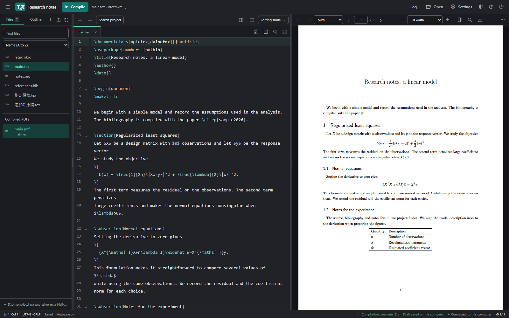
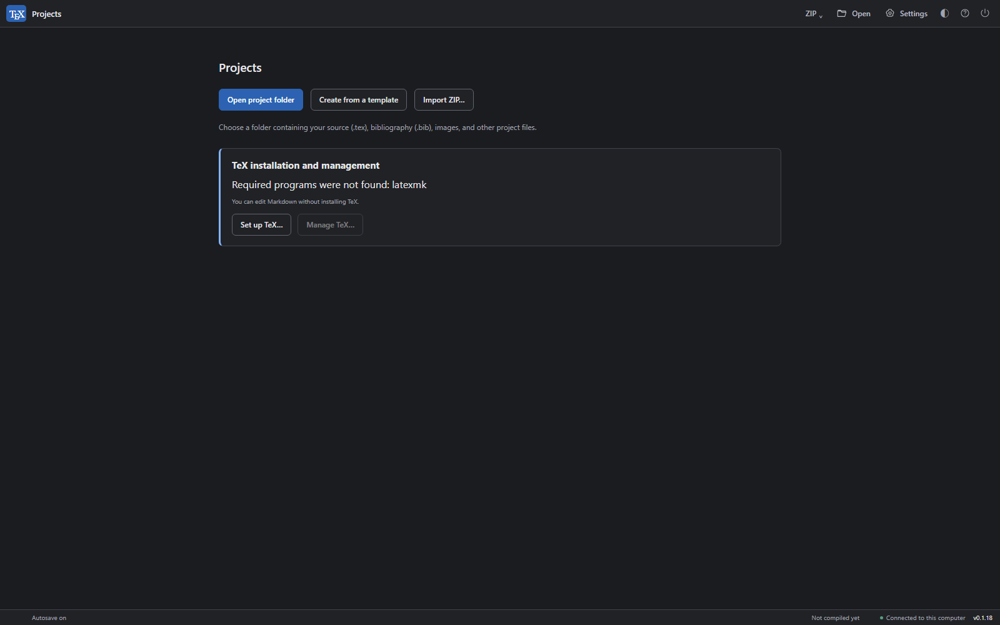
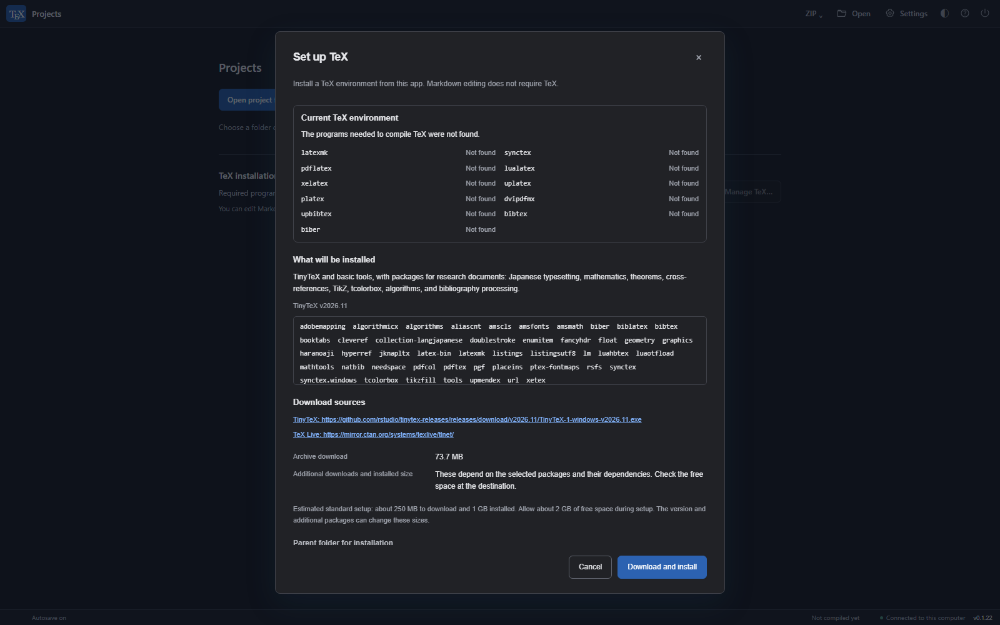
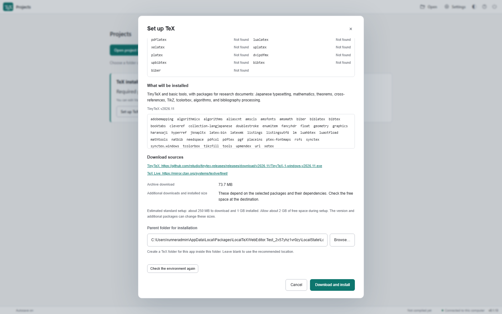
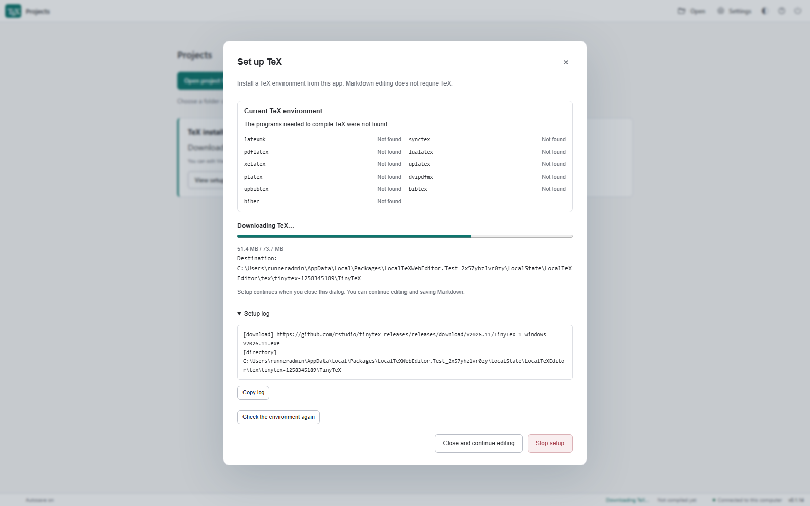
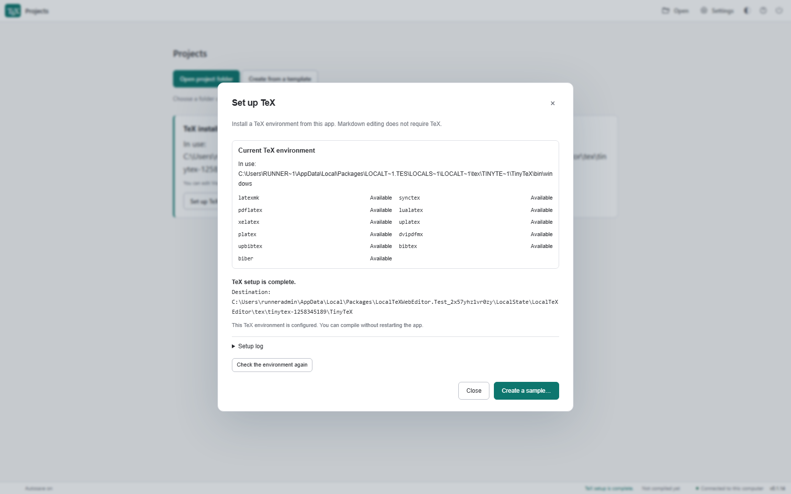
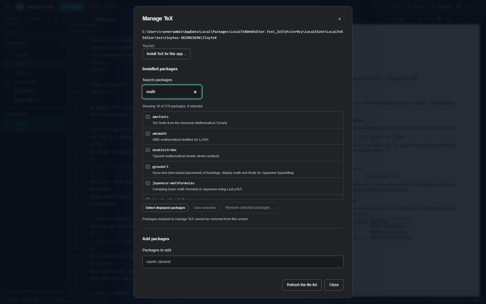
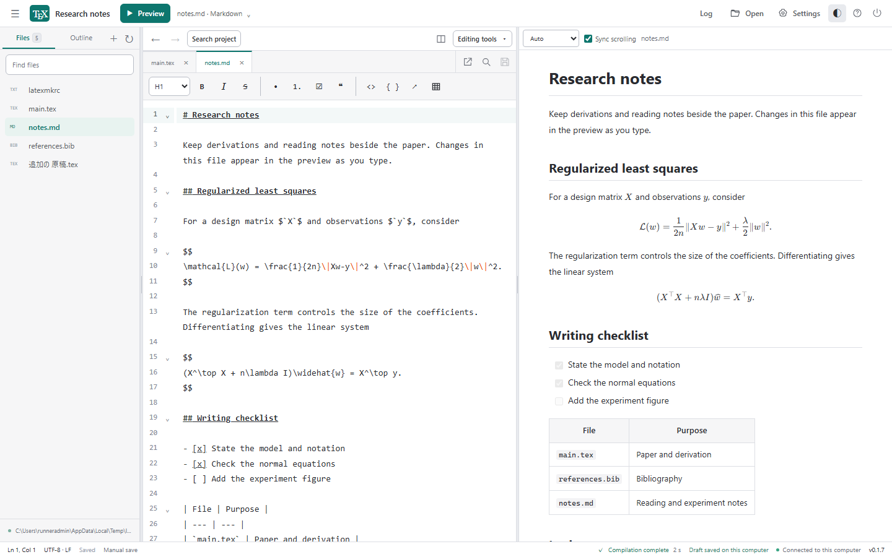

# Local TeX Web Editor

English | [日本語](README.ja.md) · [Website and guide](https://kodai-utsunomiya-mdl.github.io/Local-TeX-Web-Editor/)

[](https://apps.microsoft.com/detail/9P6QF32N19HG)
&nbsp;&nbsp;
[](https://github.com/kodai-utsunomiya-mdl/Local-TeX-Web-Editor/releases/download/v0.1.14/local-tex-web-editor-0.1.14-windows-x64.zip)
&nbsp;&nbsp;
[](https://github.com/kodai-utsunomiya-mdl/Local-TeX-Web-Editor/releases/download/v0.1.14/local-tex-web-editor-0.1.14-macos-universal.zip)

**v0.1.14** · [All downloads and release notes](https://github.com/kodai-utsunomiya-mdl/Local-TeX-Web-Editor/releases/latest) · [Get started](#first-document) · [Download and launch](#download-and-launch) · [Requirements](#requirements) · [App size](#app-files-and-storage)

The ZIP downloads are v0.1.14. The Microsoft Store update becomes available after Store review and publication.

Edit TeX and Markdown documents in your browser on Windows or macOS. On a computer without TeX, start this app and choose **Home → Set up TeX…**. The app downloads and installs TeX, selects the new environment when setup finishes, and uses it to compile your documents. Launching the app opens a `localhost` page in your default browser, with the editor and PDF preview in the same window.



Documents stay in the project folder on your computer. Compilation uses the TeX environment selected in the app and the project's `latexmkrc`; the app displays the logs and resulting PDF. The distributed app runs without installing Python, Node.js, Go, or VS Code.

## First document

1. **Get and open the app.** Choose Microsoft Store or the Windows ZIP, or download the macOS app. Follow [Download and launch](#download-and-launch) below.
2. **Choose a TeX environment.** If TeX is not installed, open **Set up TeX…** on Home and follow the [setup guide](#set-up-tex-from-the-app). The app selects the installed environment when setup finishes. If you already have TeX, [select your existing installation](#use-an-existing-tex-installation) in Settings.
3. **Create a sample.** On Home, click **Create from a template** and choose **English article** or **Japanese document**. Choose a destination folder, enter a new project name, and click **Create and open**. Immediately after TeX setup, **Create a sample…** on the completion screen opens the same chooser.
4. **Compile.** Select `main.tex` and click **Compile**. The PDF appears beside the editor.

To start with Markdown, choose its template under **Home → Create from a template**; you can edit it before installing TeX.

## Requirements

Use a supported Windows PC or Mac with a current Chrome or Edge browser. Download and launch the app first; its Home screen provides TeX setup. Markdown editing and preview are available as soon as the app opens.

| Requirement | Windows | macOS |
| --- | --- | --- |
| OS and CPU | Windows 10 / 11, 64-bit (x64) | macOS 12 Monterey or later, Apple Silicon or Intel |
| Browser | Current Chrome or Edge | Current Chrome or Edge |
| Internet connection | For TeX and package downloads | For TeX and package downloads |
| Free space for TeX setup | About 2 GB during installation | About 2 GB during installation |
| Documents | Create a sample or open an existing project folder | Create a sample or open an existing project folder |

The Microsoft Store edition requires Windows 10 version 2004 (build 19041) or later, or Windows 11, on an x64 PC.

The macOS requirement follows the [operating systems supported by Go 1.25](https://go.dev/doc/go1.25#darwin), which is used to build the app.

## Download and launch

### Windows

#### Microsoft Store

1. Open [Local TeX Web Editor in Microsoft Store](https://apps.microsoft.com/detail/9P6QF32N19HG) and install the free app.
2. Launch **Local TeX Web Editor** from the Windows Start menu. The editor opens in your default browser.
3. On Home, [set up TeX from the app](#set-up-tex-from-the-app) if TeX is not installed, or [select your existing installation](#use-an-existing-tex-installation) if you already use TeX. Then choose **Create from a template** on Home to create a sample.

Microsoft Store manages installation and app updates. The setup guide below continues from the Home screen.

#### ZIP download

1. Open [Releases](https://github.com/kodai-utsunomiya-mdl/Local-TeX-Web-Editor/releases) and select the latest version.
2. Under **Assets**, download `local-tex-web-editor-0.1.14-windows-x64.zip`. The **Source code** archives contain the files for development.
3. Extract the ZIP and double-click `local-tex-web-editor.exe`.
4. On Home, [set up TeX from the app](#set-up-tex-from-the-app) if TeX is not installed, or [select your existing installation](#use-an-existing-tex-installation) if you already use TeX. Then choose **Create from a template** on Home to create a sample.

The Windows executable in the ZIP download does not have a code signature. If SmartScreen displays **Windows protected your PC** when opening the file downloaded from this repository's release, select **More info**, check the app name, and choose **Run anyway**. See [Microsoft's guidance](https://learn.microsoft.com/en-us/windows/apps/package-and-deploy/publish-first-app).

### macOS

1. Under **Assets** in [Releases](https://github.com/kodai-utsunomiya-mdl/Local-TeX-Web-Editor/releases), download `local-tex-web-editor-0.1.14-macos-universal.zip`. The same ZIP supports Apple Silicon and Intel.
2. Extract the ZIP and move `Local TeX Web Editor.app` to **Applications**.
3. Open **Local TeX Web Editor** from Finder or Spotlight. The editor opens in your browser.
4. On Home, [set up TeX from the app](#set-up-tex-from-the-app) if TeX is not installed, or [select your existing installation](#use-an-existing-tex-installation) if you already use TeX. Then choose **Create from a template** on Home to create a sample.

The macOS app does not have an Apple Developer ID signature or notarization. If macOS blocks the first launch, confirm that you downloaded it from this repository's release, then use **System Settings → Privacy & Security → Open Anyway**. See [Apple's instructions](https://support.apple.com/en-us/102445).

## Set up TeX from the app

First [download and launch the app](#download-and-launch). The first launch uses **English**. To switch to Japanese, open **Settings** at the top right, choose **日本語** under **Language / 言語設定**, and click **Save and apply settings (設定を保存して反映)**. The same setup screens are available in both languages.

| English label | Japanese label |
| --- | --- |
| Set up TeX… | TeX をセットアップ… |
| Manage TeX… | TeX を管理… |
| What will be installed | インストールするもの |
| Download sources | ダウンロードの取得元 |
| Parent folder for installation | インストール先の親フォルダー |
| Browse… | 参照… |
| Download and install | ダウンロードしてインストール |
| Close and continue editing | 閉じて編集を続ける |
| TeX setup is complete. | TeX のセットアップが完了しました． |
| Create a sample… | サンプルを作成… |
| Create from a template | テンプレートから作成 |
| Destination folder | 保存先のフォルダー |
| Choose a folder | フォルダーを選ぶ |
| New project folder name | 新しいプロジェクトのフォルダー名 |
| Create and open | 作成して開く |
| Compile | コンパイル / コンパイルする |

### 1. Open TeX setup from Home

On the **Projects** home screen, find **TeX installation and management** and click **Set up TeX…**. You can return to Home by clicking the TeX logo at the top left. Home and Settings both show **Set up TeX…** and **Manage TeX…**. Setup creates a new environment; management opens the selected environment. **Manage TeX…** becomes available once a TeX environment has been found.



### 2. Review the programs and packages

The upper part of the setup dialog shows **Current TeX environment** and **What will be installed**. On a computer without TeX, the program list shows **Not found**. Review the TinyTeX release and the package list below it. If you already use TeX, the dialog explains that a new installation will use another folder and become this app's selection after setup finishes. To keep using your existing installation, follow [Use an existing TeX installation](#use-an-existing-tex-installation).



The initial environment includes pdfLaTeX, upLaTeX, XeLaTeX and LuaLaTeX; `latexmk`, SyncTeX and `dvipdfmx`; Japanese classes and Harano Aji fonts; and BibTeX, upBibTeX, Biber and `upmendex`. Common mathematics, figures and theorem packages include `amsmath`, `mathtools`, `mathrsfs`, `dsfont`, TikZ, `tcolorbox` with its `most` libraries, `algorithm`, `algpseudocode`, `hyperref`, `pxjahyper` and `cleveref`.

### 3. Check the download sources, space and destination

Scroll down within the setup dialog to **Download sources**. The app uses the official [TinyTeX v2026.11](https://github.com/rstudio/tinytex-releases/releases/tag/v2026.11) archive and checks its SHA-256 before extraction. The dialog also shows the source for additional TeX Live packages.

Check the archive size and the estimate for additional downloads and installed files. Allow about **250 MB of downloads on Windows** or **300 MB on Mac**, about **1 GB for the installed environment**, and about **2 GB of free space during setup**. The selected release and additional packages can change these estimates.

Under **Parent folder for installation**, use the suggested location or click **Browse…** to choose another folder you can write to. The app creates its own TeX folder inside that parent folder. Leaving the field blank uses the recommended location. The defaults are listed under [App files and storage](#app-files-and-storage).



### 4. Start installation and follow its progress

Click **Download and install** after reviewing the contents and destination. An internet connection is needed for this step. The download shows completed and total sizes with a progress bar. Extraction, package installation and checks show the current stage and an activity bar. Open **Setup log** to see the output from the running step.



**Close and continue editing** leaves setup running while you edit and save Markdown. Reopen its progress from the indicator at the bottom of the app or **View setup progress** on Home or in Settings. **Stop setup** stops the operation. After a failure or stop, **Review and try again…** returns to the contents and destination before another attempt.

The setup supports Windows x64 and both Apple Silicon and Intel Macs. It runs in your user folder with your normal permissions. Setup downloads TeX programs and packages; project documents stay on your computer. See the [privacy policy](docs/privacy.md).

### 5. Wait for the completion message

Wait until the dialog says **TeX setup is complete.** and the program checks have finished. The app selects the installed environment, so you can compile immediately. **Current TeX environment** and the destination show the selected paths.



If you started from Home with no project open, click **Create a sample…** to open **Start from a template**. You can also open this chooser from **Home → Create from a template**. If you already have a project, click **Close** to return to its editor. When the completion screen offers **Compile** for the same document you were preparing, that button starts its compilation.

### 6. Open a document and compile

For a first document, select **English article** or **Japanese document** in the template chooser. Click **Choose a folder** beside **Destination folder** and select a parent folder, such as Documents. Enter an unused name, such as `my-first-paper`, in **New project folder name**, then click **Create and open**. The app creates the project inside that parent folder and selects the compiler for its template. Select `main.tex` in the file list.

For an existing document, choose **Open project folder** on Home, use **Browse…** or enter the folder path, and click **Open**. Select the main `.tex` document in the file list. Before compiling, open **Settings → Compiler**. Choose **Use latexmkrc settings** when the project supplies `latexmkrc` or `.latexmkrc`; otherwise choose the TeX engine required by the document. Click **Save and apply settings**.

Click **Compile** in the top toolbar. The app saves the document and runs TeX. The resulting PDF appears beside the source. If compilation reports a missing package, follow [Manage TeX packages and installations](#manage-tex-packages-and-installations), then compile again.


## TeX installations and packages

### TeX programs used by the app

| Program | Purpose |
| --- | --- |
| `latexmk` | Compiles the document and repeats the required steps for citations and cross-references |
| `pdflatex`, `uplatex`, `xelatex`, `lualatex`, or another configured engine | Runs the TeX engine selected for the document |
| `synctex` | Navigates between corresponding positions in the source and PDF |
| `bibtex`, `upbibtex`, `biber`, or another bibliography processor | Processes references using the method selected by the project |
| Packages and fonts used by the document | Provides document classes, `\usepackage` dependencies, Japanese fonts, and other resources |

An upLaTeX project usually needs `uplatex` and `dvipdfmx`, and may use `upbibtex` for references. Include the project's `latexmkrc` or `.latexmkrc` when you copy the project to your computer.

### Use an existing TeX installation

If your documents already compile with TeX Live, BasicTeX, MacTeX or TinyTeX, open **Settings** and enter that installation's **TeX Live bin folder**. Typical locations are `C:\texlive\2026\bin\windows` on Windows and `/Library/TeX/texbin` on Mac. Click **Save and apply settings** to use it.

A smaller TeX installation can be extended later. **Settings → Add TeX packages** includes **latexmk and SyncTeX** and **Japanese typesetting** presets. The Japanese preset includes `collection-langjapanese`, which supplies Japanese engines, classes, fonts and their dependencies. Mathematics, figures and bibliography packages can be added by name.

### Manage TeX packages and installations

Open **Manage TeX…** on Home or in Settings to see the selected installation and its packages. Both setup and management stay visible after installation. You can search the list, enter package names under **Review packages to add…**, or select installed packages and choose **Remove selected packages…**. Before removal, the app asks `tlmgr` to list the proposed changes and displays its dependency information. Confirm with **Remove the displayed packages**. Packages needed to manage TeX remain available.

This screen supports TeX installed by the app and existing TeX Live, MacTeX and TinyTeX installations. Existing installations use their configured package repository. If `tlmgr` reports a year mismatch with CTAN, the app retries with that TeX Live year's `tlnet-final` while leaving the saved repository setting in place. Custom, local and multiple-repository configurations use their own settings. The Windows ZIP edition and Mac request operating system approval when changes require administrator rights. In the Microsoft Store edition, a shared installation can be managed through the **Open the TeX management tool** button when its official `tlshell` is installed; that tool handles its own approval and package operations.



The management screen shows the actual TeX folder alongside the package list. Searching for `math` narrows the list while the package-addition controls remain available.

**Remove the entire TeX environment…** opens a separate confirmation with the actual folder, file count, size and effect on other applications. To start removal from the app, review it, select the acknowledgment, and enter the displayed folder name. App-installed TeX is removed from its recorded folder. Existing Windows TeX Live uses its official uninstaller; existing Mac TeX and user-owned TinyTeX use the operating system's Trash or Recycle Bin. Windows asks before permanent removal if an item cannot be recycled. The Store edition opens **Uninstall in Windows Settings…** for installations that require administrator permission; choose the removal in Windows, with no folder-name entry needed just to open Settings. An official uninstaller can leave settings or other files; their locations appear in the log. Other applications using the selected TeX also lose access to it until it is installed again or restored from Trash.

To add packages from Settings:

1. Expand **Add TeX packages**.
2. Choose **latexmk and SyncTeX** or **Japanese typesetting**, or enter package names separated by spaces in **Packages to add**.
3. If a package is already listed but its files are missing, select **Download these packages again if their files are missing**.
4. Click **Review packages to add…**. Check the package list, download source and **Add to:** folder in the review dialog.
5. Click **Add these packages**, wait for completion, and compile the document again.

The management screen uses the same review and progress flow. For a shared installation that the Store edition cannot change directly, use **Open the TeX management tool** when offered, make the changes there, then return and click **Refresh packages**.

For an error such as `File 'siunitx.sty' not found`, add its package, `siunitx`, by name. If the package name is unclear, check the document's instructions or the package documentation; a file name can differ from its package name. Custom `.sty` or `.cls` files supplied by a publisher or author belong in the project folder. See [Add SyncTeX](#add-synctex) for the source–PDF navigation controls.

### Check your TeX installation

Open **Settings** to review the selected **TeX Live bin folder** and the available programs. **Set up TeX… → Check the environment again** refreshes the program checks. **Manage TeX…** shows the actual installation folder and its installed packages.

If a required program is missing, use **Add TeX packages** to review and add it to the selected installation. The dedicated **Add SyncTeX…** button appears when source–PDF navigation needs SyncTeX. After adding packages, compile the document again so its PDF and SyncTeX data match the source.

## Projects and app updates

### Open a project and finish a session

To use a project from Overleaf, download its source as a ZIP, extract it, and open that folder. For a project obtained from GitHub or another source, select the folder containing the `.tex` and `.bib` files, images, `latexmkrc`, and other project files.

The app keeps running when an editor browser tab sleeps, is discarded, or closes. Returning to the tab reconnects to the same local address. Launching the same version again opens the running editor. Drafts and tab positions are recorded when the page becomes inactive and are available when you return. The browser asks for confirmation when a document has unsaved edits.

Use the exit button at the top right to stop the app and any running compilation. If there are unsaved edits, choose whether to save them to the project files or leave them as drafts. If the browser does not allow the tab to close automatically, the page shows that the app has stopped. Close the tab with `Ctrl + W` on Windows or `Cmd + W` on Mac.

### Update the app

For the **Microsoft Store edition**, use Microsoft Store to install app updates, then open the app from the Start menu.

For the **Windows ZIP edition**, extract the new ZIP and launch its `.exe`. If another version is running, the app shows both the running version and the version you just launched. Save your documents and exit the old version to open the new one. Settings shows the app version and the path of the running executable.

On Mac, save your documents and exit the app, replace the old copy in **Applications** with the new `Local TeX Web Editor.app`, then open it. Settings and drafts are loaded from your user configuration folder.

Launching the same version again connects to the existing editor. A project lock also prevents multiple app processes from compiling the same project at the same time.

### Launch from the Start menu or desktop (Windows)

The **Microsoft Store edition** appears in the Start menu after installation.

For the **ZIP edition**, create a shortcut from the app:

1. Open **Settings**.
2. Under **App shortcuts**, click **Add to Start menu** or **Create on desktop**.
3. Next time, find **Local TeX Web Editor** in the Start menu or open the desktop shortcut. The app and browser will open.

This places the app at `%LOCALAPPDATA%\Programs\LocalTeXEditor\local-tex-web-editor.exe`. The shortcut continues to work if you move the original download folder. Copies of the ZIP edition use the same settings and drafts.

The executable, shortcuts, and browser tab use a white TeX icon on a green background.

Launching the `.exe` from a new ZIP updates the installed copy and the Start menu or desktop shortcuts you have already created. The same shortcuts then launch the new version.

## Edit documents

The interface starts in **English**. In **Settings → Language / 言語設定**, select **English** or **日本語** to see the interface change immediately. **Save and apply settings** uses the selected language for future sessions; **Cancel** or `Esc` returns to the saved language. The label always shows both languages. Documents, PDFs, and Markdown content are displayed as written.

Open `.tex`, `.bib`, Markdown, Python, JavaScript, and other supported text files from the file list on the left. Each file opens in a tab, and you can drag tabs to change their order. Use a mouse wheel, horizontal trackpad gesture, or touch to move through a long tab strip. **Close all tabs** above the editor offers Save, Discard, or Cancel when there are unsaved edits. The next session restores the open tabs and their order, including a strip with no open tabs. Settings lets you choose an editor font size from 8 to 40 px; the default is 14 px. The font size is saved for future sessions.

Drag the right edge of the file list or outline to change its width, the divider between the editor and preview to change their widths, or the top edge of the log to change its height. You can also focus a divider with `Tab` and use the left/right or up/down arrow keys. Double-click a divider to restore its default position. Your chosen sizes are saved for future sessions and adjusted to fit smaller windows.

Expand folders in the file list to browse their contents. Selecting an image or PDF opens it in the editor's tab area. Returning to a source tab restores the text and cursor position you were working with.

Selected text has a visible background in both themes, including selections on the current line and selections left in the editor after you move focus elsewhere.

| Action | How to use it |
| --- | --- |
| Find files or headings | Use the search field on the left. **Outline** shows headings from the selected TeX or Markdown tab. Click a heading to show its source line near the top of the editor, with space above it |
| Insert citations | Inside `\citep{` or `\cite{`, completion offers keys from the project's `.bib` files, with author, year, and title information |
| Insert cross-references | Inside `\ref{`, `\eqref{`, `\cref{`, and similar commands, completion offers labels from the source |
| Open completion | Type a TeX command or press `Ctrl + Space`. Use `Tab` / `Shift + Tab` to move between the inserted arguments |
| Fold source | Click an arrow beside the line numbers to fold or unfold a section, environment, Markdown heading, or code block |
| Search and replace in source | Press `Ctrl + F` in the editor or click the **Find and replace** button. You can paste a selection containing multiple lines |
| Search the whole project | Click **Search project** or press `Ctrl + Shift + F`. Review the results and select the occurrences to replace |
| Return after following a reference | Use the **←** / **→** buttons above the source or PDF, or press `Alt + Left` / `Alt + Right` |
| View two source documents | Click **Open two source editors**, then choose a document above each editor |
| Compare earlier text | Open **Editing tools → Document history** |
| Inspect a citation or reference | Open **Editing tools → References and citations** to find definitions and uses |
| Insert an image or table | Right-click in the manuscript, or use **Editing tools → Insert an image** or **Insert a table** |
| Change the editor font size | In source or Markdown visual editing, use `Ctrl + wheel`, pinch on a touchpad, or pinch with two fingers on a touchscreen. Both editor panes and Settings use the new size, which is saved for future sessions |
| Save | Press `Ctrl + S` for the current file or `Ctrl + Shift + S` for all open files |
| Compile | Press `Ctrl + Enter` or click **Compile**. The app saves the files and compiles the TeX document selected by the active editor tab |
| Review errors and warnings | Open **Log**, choose a category, and click an item with a file name and line number to open the source |

On Mac, use `Cmd` in place of `Ctrl` for saving, searching, compiling, and the SyncTeX click action. Change the editor text size with `Ctrl + wheel`, `Cmd + wheel`, or a trackpad pinch.

The search and replacement fields accept newlines and TeX backslashes as entered. Press `Enter` for the next match, `Shift + Enter` for the previous match, and `Ctrl + Enter` to insert a newline in a field. A checkbox enables regular expressions. Close the search panel with its **×** button or press `Esc` while a search field has focus.

Changing the font size or theme leaves the document content and compiled PDF unchanged. The notice to recompile appears when source files or compilation settings have changed.

### Manage project files and edit code

Click the **TeX logo** to open Home and manage the current and recent projects. **Return to editing** brings you back to the same editor, including unsaved text, tabs, and cursor positions. Each project card shows its name and full folder path.

The app checks the folders again when you open Home or return to the browser window. A card explains when a folder was moved, deleted, or cannot be read. Use **Check again** after reconnecting a drive or restoring a folder, or choose its new location from the project picker. **Remove from recent** removes a list entry and leaves the project files, settings, and drafts on your computer. If the current folder is unavailable, you can continue editing its open text and recording drafts; saving project files and compiling resume when the folder is available again. Saved PDF previews remain available.

**Delete…** on a project card opens a review of all files and folders, including hidden items and saved drafts. To delete the folder from your computer, tick the acknowledgment and type its exact project name, then choose **Delete project**. If a file or draft changes after the review, the app updates the list and asks you to review it again. Deleting a project removes its saved drafts and recent-project entry as well.

Right-click a file, folder, or the empty area of the file list to create a file or folder at that location, or choose **Add files from your computer…** to select existing files. The same file picker is available beside the **＋** button. Selected files are copied into the project; choose the destination folder and review any existing filenames. For each conflict, choose to replace the file, add a copy under another name, or skip it. Files with open tabs or saved drafts must be closed or reviewed before replacement. Multiple files can be selected, with a limit of **128 MiB per file**. The **＋** button continues to accept a project-relative path for a new file.

The context menu also offers relative and full path copying, renaming, and **Delete…**. From the keyboard, focus the entry and press `Shift + F10` or the context-menu key. Use the arrow keys to select an action, `F2` to rename, and `Delete` to open the deletion confirmation. A folder's confirmation shows its contents and unsaved documents, and can delete the folder together with those contents. Renaming updates the open tabs and their editing state, including unsaved text. References written inside other documents remain as written, so update those links when needed.

Choose **Create a copy…** to copy a file or a folder within the project. Review the destination path and any files with unsaved edits before creating the copy. Copies use the contents saved on disk; the original tabs remain available with their unsaved edits. Choose a different destination if that name already exists.

The new-file dialog lets you start with an empty file or choose a built-in or custom template. For a template with several files, select one text file and review its contents before creating the new file. The destination starts in the folder selected from the context menu; you can edit the project-relative path before creating it.

Use the sorting control below **Find files** to sort by name in either direction, put the newest or oldest items first, or choose a manual order. Name and date sorting place folders before files at each level, and filtering uses the selected order. Modification times come from the operating system for each file or folder. Saving updates the order immediately; refreshing the file list or returning to the tab picks up changes from other applications. The selected order is saved for the next session.

Drag an entry between other entries to arrange it manually; the list switches to **Manual order** automatically. `Alt + Up` and `Alt + Down` move the focused entry within the list. Drop an entry onto the center of a folder to move it into that folder. Moving updates open tabs and unsaved edits and stops if the destination already contains that name. Use the sorting control to return to name or date order.

Program and configuration files can be edited with the same saving, search, drafts, and history tools. Syntax highlighting covers Python, JavaScript/TypeScript, C/C++, Java, Kotlin, C#, Go, Rust, R, Ruby, shell, PowerShell, HTML, CSS, XML, SQL, JSON, YAML, TOML, and Lua. Other supported text formats open as plain text. `.ipynb` opens as JSON text. The editor does not run these programs.

### Complete TeX and navigate the outline

Typing `\b` offers `\begin`. Completing it puts the cursor inside `\begin{}`; typing `i` there offers `itemize`, which inserts the item body and `\end{itemize}`. Commands for sections, formatting, citations, references, figures, tables, and mathematics are included. For example, `\frac` creates numerator and denominator fields. Press `Tab` or `Shift + Tab` to move between fields. Environments defined with `\newtheorem` or `\newenvironment` in the current document also appear in the list.

Citation details appear beside the candidate list, or below it in a narrow editor, with their own scrolling area. In **Settings**, **Enable TeX completion** enables the feature, and **Show suggestions while typing** controls automatic suggestions. When automatic suggestions are off, `Ctrl + Space` still opens completion.

The outline uses vertical guides and arrows to show heading levels. Click an arrow to collapse its children, or click the heading to open its source line. In the source, arrows beside the line numbers fold sections and environments; Markdown headings and code blocks can also be folded. Source jumps from the outline, search, and PDF unfold the destination when needed. The keyboard commands are listed under **Help → Keyboard shortcuts**.

### Search and replace across the project

**Search project** searches the text of `.tex`, `.bib`, Markdown, and other supported text files. Unsaved documents use the text currently in the editor. Generated compilation files are omitted. Select a result to open its location in the source.

Enter the replacement text before searching to see the before/after preview for each occurrence. Tick the occurrences you want to change, or use **Select / clear all**, then choose **Replace … selected matches**. Replacement saves the affected files. The app checks both the current editor text and the disk revisions before saving; if a file has changed, search again to review the new text.

The dialog supports multiline text, case matching, whole words, and regular expressions. Regular expressions use RE2, with `$1` or `${name}` for captured text in replacements. Results are limited to 1000 matches, and **Cancel search** stops a search. A message appears when file sizes or another search limit prevent a complete search; use a more specific query in that case.

### Work in two source editors

Click **Open two source editors** above the tabs. The selectors above the two editors let you choose different documents, or view two parts of the same document. Each editor has its own cursor and scroll position. Changes to the same document appear in both views, and Undo and Redo work from either view.

Drag the divider to change the space given to each editor. In a narrow window, the editors appear above and below one another. Click **Close the second editor** to return to one source view. The app restores the two displayed documents, the active editor, their positions, and the divider size when you reopen the project.

### Check citations and cross-references

Place the cursor on a citation key or label and open **Editing tools → References and citations**. You can also search the list by key, title, or author. **Definitions** and **Uses** show excerpts and links to their source locations.

To change a key, enter its new name under **Rename the key**, choose **Preview changes**, and review the affected lines before choosing **Apply these changes**. The operation covers standard citation and reference commands; comments, code examples, and custom command definitions stay as written. The app checks the files again before saving the changes.

### Compare and restore earlier text

Open **Editing tools → Document history**, select an earlier version, and tick the changes you want to bring back. Select several changes, use **Select all changes**, or hold `Shift` while clicking a checkbox to select a range. **Restore … selected changes** applies them together to the editor, where you can use Undo or continue editing before saving. Large rewrites may appear as one selectable change. **Record current text** lets you record the current text with an optional version name, including text you have not saved yet.

Use the checkboxes beside recorded versions to select versions you no longer need. **Select all versions** and `Shift`-click also work in this list. Choose **Delete … selected versions…**, review the names and dates, and confirm their deletion. This removes the selected records from edit history; the current document remains as written. Deleted history cannot be recovered.

Automatic history is enabled initially. When an edited file is saved, the app compresses its previous text, with at least one minute between automatic versions of that file. Open **History settings** in the same dialog to change the period or total storage, or clear **Record edit history** to stop recording new versions.

| History setting | Default or limit |
| --- | --- |
| Period | 30 days; adjustable from 1 to 365 days |
| Total compressed storage | 50 MiB; adjustable from 5 to 200 MiB |
| Versions of one file | At most 50 |
| Versions across all projects | At most 2000 |
| Document size | At most 2 MiB per version |

Older versions are removed when an age, capacity, or count limit is reached, including versions with names. Turning history off stops new records; existing versions remain subject to those limits. History is stored in the app's local data folder listed under [App files and storage](#app-files-and-storage).

### Insert images and tables

Paste an image from the clipboard, drop a file onto the source editor, or open **Editing tools → Insert an image**. The dialog accepts one PNG, JPEG, or PDF at a time, up to **8 MiB**. Choose its destination in the project and review the source to insert. Existing filenames receive a numeric suffix for the new copy. TeX insertion supports a caption, label, and width and uses `graphicx`; Markdown insertion uses a relative image link, or a normal link for a PDF.

Open **Editing tools → Insert a table** to paste tab- or comma-delimited cells copied from a spreadsheet. You can also enter **Rows** and **Columns** and choose **Create a new table**. Edit the preview cells, choose whether the first row is a header, and review the TeX or Markdown source before inserting it. Tables support up to 500 rows, 50 columns, and 10,000 cells in total. The preview displays the first 30 rows and 12 columns; the inserted source includes the whole table.

### Create a project from a template

Choose **Create from a template** on the opening screen, or **Editing tools → Manage templates** in a project. Built-in choices include a Japanese LuaLaTeX document, an English article, Beamer slides, and Markdown notes. Select a template, its destination folder, and a new project folder name, then choose **Create and open**.

To add your own template, expand **Add the current project as a template**, enter a name, and select the source files and images to include. **Save and add as a template** saves the open documents and registers those files. Generated PDFs, auxiliary compilation files, and edit history are omitted. Each custom template can contain up to 200 files and 32 MiB, with up to 20 custom templates. You can rename a custom template, edit its description, or delete its registration under **Edit the selected template**.

### Choose the appearance

Open **Settings → Appearance** to choose **System**, **Light**, or **Dark** mode, one of seven color schemes (**Gray**, **Black**, **Blue gray**, **Warm**, **Navy**, **Forest**, or **Plum**), one of eight accent colors, and one of ten editor fonts. For a black background, select **Dark** mode and the **Black** color scheme. **System** follows your computer's light/dark preference. The dialog shows a sample of the selected appearance.

Use the color picker or enter a hexadecimal color code to choose the background, text, and accent colors. Light and dark modes save their colors independently. Clearing a code returns that color to the selected scheme. The selected colors also apply to dialogs, completion popups, notifications, and compilation and draft status messages.

Notifications and floating menus use their own background and border colors with a visible shadow. Their text colors follow the chosen background in light and dark modes, including custom colors.

The initial appearance uses **System** mode, the **Gray** color scheme, and **Consolas** for the editor. Gray and Consolas appear first in their lists and are marked as the defaults. Your previously saved appearance continues to apply. If Consolas is unavailable, the editor tries Cascadia Code, Menlo, DejaVu Sans Mono, and the browser's monospace font in that order.

Changes appear immediately. Choose **Save appearance** to use them in future sessions. **Cancel**, `Esc`, or **×** restores the appearance you had when opening the dialog. **Reset appearance** previews the defaults; choose **Save appearance** to apply them.

The theme button at the top right switches directly between light and dark mode and continues to use your selected color scheme, accent, and font. If the selected font is unavailable on your computer, the editor uses the default monospace font.

### Help and feedback

Click the **? (Help)** button at the top right, or press `F1`, to open the help window. It includes the user guide, keyboard shortcuts, release notes, troubleshooting steps, and a link to the update page for your edition. The troubleshooting section also opens the compilation log or Settings.

Under **About the app**, review the version, operating system, app architecture, edition, and available TeX programs. Use **Copy environment information** to copy these details, and **Open GitHub Issues** to report a problem or suggest a change. For a problem, include the steps that led to it and the relevant part of the compilation log.

Close help with `Esc`, **×**, or a click outside the window.

### Autosave and returning to your work

Autosave is enabled initially. The app saves the source file when typing pauses. You can continue editing while compilation runs; autosave waits until compilation finishes. Turn autosave off in Settings if you prefer to save manually.

Drafts are recorded on your computer in addition to saving the project files. If a draft is available when you reopen the app, choose **Review drafts**, compare it with the file, and select **Open draft in the editor**. If another application changes a source file, the app lets you compare the disk version with your edits and choose what to save.

The app also checks open documents for changes on disk during its regular refresh and when you return to the browser window. A document with no unsaved edits loads the new text. A document being edited shows **Review changes** so you can compare both versions. If a file was deleted outside the app, its open text and draft remain available; the comparison dialog lets you confirm creating the file again from the editor's contents.

The next session opens the previous project and restores all open tabs in their order, the two-editor layout when used, source cursor and scroll positions, the PDF page, and the zoom level. The last successfully compiled PDF is available immediately for reading.

### Reset settings and remembered information

Open **Settings → Information saved by the app → Reset settings and remembered information…**. The dialog shows the app-data location and the number and size of the files in each category.

| Choice | Selected initially | Effect |
| --- | --- | --- |
| Settings and remembered actions | Yes | Returns appearance, editing preferences, recent projects, open tabs, editing positions and the selected TeX installation to their defaults |
| Unsaved drafts | No | Deletes the app's copies of text that has not been saved to project files |
| Edit history | No | Deletes the recorded earlier versions of documents |
| Your templates | No | Deletes templates you added |
| PDF and SyncTeX cache | No | Deletes the app's copies used to preview compiled documents |

Choose the information to reset, select **I confirm that I want to reset the selected information**, then click **Reset selected information**. If an open document has unsaved changes, choose **Save and reset** or **Keep drafts and reset**. When you selected **Unsaved drafts**, the second choice becomes **Discard changes and reset**. **Cancel** returns to your work.

The app reloads after a successful reset. Resetting settings returns to Home; open the project folder again to resume. When you select only drafts, history, templates or the preview cache, the current project and settings remain in use. Other open tabs ask to reload when they next connect. Their notice offers downloads of unsaved documents before you reload them.

Project files and installed TeX remain available, including TeX installed inside the app-data folder. Use **Manage TeX…** for package changes or removal of a TeX installation. See the [privacy policy](docs/privacy.md#managing-your-data) for the saved data and its locations.

### Create a linked Markdown page

With a Markdown document open, choose **New page** in the formatting toolbar above the source, or **Editing tools → New Markdown page**. Enter a title and a path in an existing project folder. The dialog previews the relative link that will be inserted at the current selection and can open the new page afterward. The new file starts with its title as a heading. Existing files are not overwritten. Undo in the original document removes the inserted link; the created page remains in the project.

### Convert Markdown and PDF

Choose **Editing tools → Save Markdown as PDF** to preview the current Markdown, including unsaved text, mathematics, tables, and project images. Choose **Print / Save as PDF**, then select the browser's PDF destination. Page size and margins are set in that print dialog. This works without TeX Live.

To extract text, display a compiled PDF or open a project PDF, then choose **Editing tools → Convert PDF to text**. Review the preview and choose **Download TXT**. Text is collected in page order; extraction has a progress display and can be cancelled. Scanned pages need OCR, which is outside this conversion. Complex columns, equations, and font mappings can affect the text order and characters in the result.

These tools reuse the Markdown renderer, browser printing, and PDF.js already used by the app.

### Edit Markdown

Opening a `.md` or `.markdown` file starts in **Visual editing**. Edit the displayed headings, paragraphs, lists, tables, and code directly. Tick task checkboxes and select a displayed equation to edit its TeX. Changes are saved as Markdown through the same autosave, drafts, and undo history used by the source editor.



Use the **Visual editing / Source** selector above the document to edit the Markdown notation. Switching modes leaves the document text unchanged. When editing a block visually, other blocks continue to use their original Markdown. Each of the two editor panes remembers its chosen mode, so the same file can be displayed in both modes at once.

To change the text size in Visual editing, use `Ctrl + wheel` (`Cmd + wheel` also works on Mac), a trackpad pinch, or a two-finger pinch on a touchscreen. Visual editing and source editors share the 8–40 px size shown in Settings, including when two panes are open. The app saves the chosen size for the next session.

Visual editing starts with the preview closed. Markdown source editing and TeX editing start with it open. **Show preview / Hide preview** changes this for the current mode, and the app remembers the choice. Reopening the preview restores its previous width. With the preview type set to **Auto**, a visible preview follows the edited file and updates as you type. Click **Preview** or press `Ctrl + Enter` to save and refresh it.

The Markdown editing toolbar works in both modes. Select text or place the cursor, then choose a heading level, bold, italic, strikethrough, a bullet or numbered list, a task list, a blockquote, or inline code. In visual editing, buttons show the formatting at the cursor and the formatting selected for the next characters. A selection containing both formatted and plain text shows a mixed state. **Insert a link** lets you enter the display text and a web, email, or project-relative destination. **Code block** accepts code and an optional language name. Image insertion, table creation or pasting, and linked Markdown page creation use icon buttons; hover over an icon to read its name. These actions edit the Markdown source and can be undone across mode changes.

Right-click in a TeX or Markdown manuscript to insert an image or table at the clicked position or into the current selection. Markdown also offers linked pages, links, math, and code blocks in either editing mode. Press `Shift + F10` to open the menu at the cursor, or use `Shift + right-click` to open the browser menu for copy and paste.

**Insert math** opens a dialog in either editing mode. Choose inline or display math, enter the TeX, and check the rendered equation and the Markdown that will be inserted. Inline math uses GitHub's ``$`…`$`` format by default; `$…$` and `\(…\)` are also available. The dialog remembers the chosen form while the editor is open. GitHub documents the backtick form in [Writing mathematical expressions](https://docs.github.com/en/get-started/writing-on-github/working-with-advanced-formatting/writing-mathematical-expressions).

In visual editing, type an inline equation with its closing delimiter to render it within the paragraph. A line containing `---` becomes a horizontal rule when followed by `Enter` or a space. Markdown shortcuts also work next to Japanese text. Japanese italic and strikethrough text appears in visual editing, preview, and printing, including combinations of formatting and text next to punctuation. Code blocks and inline code display their contents as code.

The preview toolbar offers **Auto**, **PDF**, and **Markdown**. Choose **PDF** to read the PDF while editing Markdown. Choose **Markdown** to keep the last edited Markdown document visible when you switch to a TeX tab. The chosen preview remains visible after saving or compiling. Return to **Auto** to follow the file being edited. The project remembers this choice for the next session.

Mathematics supports `$...$`, GitHub's dollar-and-backtick syntax, `$$...$$`, fenced `math` blocks, and `\(...\)`. Use paths relative to the Markdown file for images inside the project. External images appear as links that open their URLs in the browser.

To move from Markdown source to its preview, `Ctrl + click` a source line (`Cmd + click` on Mac), or place the cursor and click the arrow button above the editor. The corresponding passage in the preview is briefly highlighted. Double-click a paragraph or heading in the preview to move to its source line.

In source mode, use **Sync scrolling** in the Markdown preview toolbar to link scrolling in both directions: scrolling the source moves the preview, and scrolling the preview moves the corresponding source view. Clear it to scroll them independently. It is enabled initially, and your choice is saved for future sessions. Each Markdown document has its own saved preview scroll position.

Relative links in the preview can open other project documents. In visual editing, use `Ctrl + click` (`Cmd + click` on Mac) to follow a link. Returning to the PDF preview shows the last compiled PDF.

## Read the PDF and navigate to source

The file list includes **Compiled PDFs**, with the latest successful result for each TeX document. Each entry shows the actual PDF name and the path of the TeX document used to compile it. Select an entry to open it in the PDF preview while leaving the manuscript tabs in place. Its context menu offers **Open**, **Save PDF**, **Copy into project…**, and **Delete…**. Copying lets you choose a project destination and review any existing name. The list is available again when you reopen the project; a failed compilation leaves its previous successful PDF available.

To remove a compiled result, right-click its entry, choose **Delete…**, review the TeX document and the number of files, and choose **Delete**. This removes that document's stored PDF previews and SyncTeX data, including earlier versions, together with its compilation output and auxiliary files under `.local-tex-editor/build`. The TeX source and PDFs saved or copied as ordinary files stay in place. If the displayed result is deleted, the preview opens the most recent remaining PDF or becomes empty when none remain. Compile the TeX document again to create a new PDF and return it to the list.

The PDF scrolls continuously across pages. The app prioritizes rendering the visible page and nearby pages, so a long document does not require rendering every page into an image at once. You can select and copy PDF text and follow links inside the PDF. After following an internal reference link, use **←** above the PDF to return to the position you were reading; **→** moves forward again. `Alt + Left` and `Alt + Right` provide the same navigation from the source or preview. Source links, search results, outline entries, and SyncTeX jumps also participate in this navigation.

The PDF toolbar uses one row. **Back**, **Forward**, **＋**, **−**, **Save PDF**, and the page-number field stay visible in a narrow preview. **… (PDF actions)** is available at every width and shows the PDF file name, the path of the TeX document compiled to produce it, and its update status. As space decreases, the zoom selector, dark display, search, preview selector, and previous/next page buttons move into that menu.

Hover over a citation link in the PDF, or focus it with `Tab`, to see the title, author, and year from the project's `.bib` files. This works with citation links created by hyperref, natbib, and biblatex, in both the compiled preview and project PDF tabs. Clicking the citation still opens its destination. Press `Esc` to close the tooltip. Bibliography entries become available as the project files are read and update when their text is edited.

| Action | How to use it |
| --- | --- |
| Zoom | **＋** / **−** and the zoom selector use the PDF position at the center of the preview. `Ctrl + wheel` and pinch zoom around the pointer or gesture position |
| Fit the view | Choose **Fit width** or **Fit page** from the zoom menu |
| Go to a page | Enter a page number or use the left and right arrows |
| Search PDF text | Click **Find in PDF** or press `Ctrl + F` while the PDF has focus. Use `Enter` / `Shift + Enter` for the next / previous result |
| Go from PDF to source | Double-click text in the PDF. The corresponding `.tex` file opens, with space above the destination line near the top of the editor; the line is briefly highlighted |
| Go from source to PDF | `Ctrl + click` a source line, or place the cursor and click the arrow button above the editor to show that position in the PDF. The corresponding PDF position is briefly highlighted |
| Export the PDF | Click **Save PDF** |
| Read with a dark background | Toggle **Dark PDF view** in the PDF toolbar. The choice also applies to project PDFs and is saved for the next session |

Dark PDF view changes the colors shown on screen, including figures and photographs. Saving the PDF uses the original file and colors.

Source–PDF navigation uses TeX Live's `synctex`. The app generates SyncTeX data during compilation and stores it with the matching PDF. TeX macros and the layout of equations can map a clicked character to a nearby source line. Editing the source after compilation displays a notice that the PDF can be updated.

### Review compilation errors and warnings

Open **Log** to see a list above the complete compilation output. Filter it by **Errors**, **References**, **Citations**, **Overfull / underfull boxes**, or **Other warnings**. Select an item with a file name and line number to move to that source location. While compilation runs, the list reflects the available output; when it finishes, the list shows the issues remaining in the final TeX pass.

### Add SyncTeX

The standard TeX setup already includes SyncTeX. If **Settings → Source–PDF navigation (SyncTeX)** reports it as missing:

1. Click **Add SyncTeX…**.
2. Review the selected TeX folder and packages. Windows also needs the `synctex.windows` executable package; the app includes it when required.
3. Click **Add these packages** and wait for completion. This flow can download files again when a package is registered but its executable is missing.
4. Compile the document once in the app, then use **Go to PDF** or double-click the corresponding text in the PDF.

For a shared installation in the Store edition, the button can open the official TeX management tool. Add the packages there, return to the app, and check the environment again. If no TeX installation is selected, **Set up TeX…** provides an environment that includes SyncTeX.

After recompiling, the PDF stays near the page you were reading. If compilation fails or is stopped, the last successful PDF remains available while you edit. Open **Log** at the top right for compilation details; it opens automatically after a failed compilation.

## Configure compilation

The active `.tex` tab selects the document to compile. If the open file contains `\documentclass` or `\begin{document}`, clicking **Compile** builds that document and displays its PDF. Switching TeX tabs alone leaves the displayed PDF unchanged. The top toolbar shows the next compilation target. **… (PDF actions)** identifies the PDF on screen and the TeX document used to produce it, including when a later compilation fails and the previous PDF remains visible.

When editing a chapter included with `\input`, a shared preamble, or another supporting file, compilation uses **Default main document** in Settings. To choose a parent document for an individual file, add a comment such as `% !TeX root = ../main.tex`. The path is relative to the folder containing that file.

The app records the PDF page and zoom for each document. If compilation of a different document fails, you can continue working with the previous successful PDF and its SyncTeX data.

For a project with an existing `latexmkrc`, choose **Use latexmkrc settings** as the compiler. The app uses the `uplatex`, `upbibtex`, `dvipdfmx`, and other commands configured in `latexmkrc` or `.latexmkrc`.

For projects without `latexmkrc`, you can select pdfLaTeX, upLaTeX, XeLaTeX, or LuaLaTeX. The app runs `latexmk`, which also handles the repeated runs needed for references and citations.

Intermediate files are stored for each document under `.local-tex-editor/build` inside the project. Later compilations reuse that document's intermediate files. If you manage the project with Git, you can add the following to its `.gitignore`:

```gitignore
.local-tex-editor/
```

The app does not impose a compilation time limit. Use the stop button to stop a running compilation.

## App files and storage

The table below records the measured **v0.1.14** files, rounded to the nearest MB (1 MB = 1,000,000 bytes). The Assets section of the [current release](https://github.com/kodai-utsunomiya-mdl/Local-TeX-Web-Editor/releases/latest) shows each current download's size.

| Platform | ZIP download | App after extraction |
| --- | ---: | ---: |
| Windows x64 | About **9 MB** | About **18 MB** (`.exe`) |
| macOS, Apple Silicon + Intel | About **17 MB** | About **36 MB** (`.app`) |

The ZIP also includes the README files, screenshots, and licenses. The macOS app contains both CPU versions. The Windows ZIP and macOS download buttons above link to the current release files.

The app includes the JavaScript, PDF.js worker, fonts, and other files needed by the editor. It uses the browser on your computer. TeX is downloaded separately when you choose the app's setup, or you can select an existing installation. The app download excludes TeX, a browser engine, Python and Node.js.

Disk usage also grows with your project files, TeX packages, drafts, and generated PDFs. Compilation files are written under `.local-tex-editor/build` in each project; their size depends on the document and its figures. The ZIP can be deleted after extraction. Creating a Start menu or desktop shortcut in the Windows ZIP edition copies the executable to the application folder described above. After closing the app and checking that the shortcut opens it, the extracted download folder can be deleted as well.

Settings, drafts, edit history, custom templates, previous view positions, and copies of the PDF and SyncTeX data use these folders:

- **Microsoft Store edition:** the app package's `LocalState\LocalTeXEditor` folder. See [the full path and migration details](docs/microsoft-store.md#installation-and-data).
- **Windows ZIP edition:** `%APPDATA%\LocalTeXEditor`.
- **macOS:** `~/Library/Application Support/LocalTeXEditor`.

TeX installed from the app uses a separate installation folder under the following default locations. You can choose another location in your user folder before setup.

| Edition | Parent folder for TeX installations |
| --- | --- |
| Windows ZIP | `%LOCALAPPDATA%\LocalTeXEditor\tex` |
| Microsoft Store | The app package's `LocalState\LocalTeXEditor\tex` folder |
| macOS | `~/Library/Application Support/LocalTeXEditor/tex` |

On the first launch, the Store edition imports valid settings, drafts, and view preferences from the ZIP edition when available. The ZIP edition's original data stays in its folder. Source files are saved in the project folder you selected. Using a copy of the PDF lets you keep reading while TeX writes the next version.

The server listens only on a loopback address such as `127.0.0.1`. File and compilation APIs use a token generated when the app starts.

## Why this editor exists

Local TeX Web Editor brings a browser editing workflow to the TeX Live installation on your computer.

Long documents can reach Overleaf's compilation time limit. Compiling on the computer allows work to continue with the available local resources. Multiline search also makes it possible to paste a block of prose or TeX code directly into the search field.

VS Code provides a broad set of development features. For editing TeX documents, starting a full desktop development environment can add more features and memory use than the task needs. This editor brings document editing, compilation, and preview together in a browser window.

Continuous PDF scrolling, SyncTeX, and Markdown preview support writing and reviewing documents while using the project files and TeX installation already on the computer.

## Development

These instructions are for building and developing the app. The distributed `.exe` and `.app` include their runtime and can be launched directly.

Development requires Node.js 22.13 or later and Go 1.25 or later. Tests also use TeX Live / TinyTeX and Chromium. Building the macOS `.app` requires Xcode Command Line Tools.

Build on Windows:

```sh
npm ci
npm run test:unit
npm run build
npm run build:windows-resources
go test ./...
go build -o bin/local-tex-web-editor.exe ./cmd/local-tex-editor
```

Build a Windows distribution executable:

```sh
go build -trimpath -ldflags="-s -w -H=windowsgui -X main.version=0.1.14" -o dist/local-tex-web-editor.exe ./cmd/local-tex-editor
```

`build:windows-resources` generates Windows x64 resources from the bundled ICO. The executable embeds nine icon sizes from 16 to 256 px.

Build on macOS:

```sh
npm ci
npm run test:unit
npm run build
go test ./...
npx playwright install chromium
node scripts/build-macos.mjs
```

This creates `dist/local-tex-web-editor-0.1.14-macos-universal.zip` with an app supporting Apple Silicon and Intel, the English and Japanese READMEs, and license files.

Command-line options:

```text
--project PATH       Project folder to open
--tex-bin PATH       Folder containing TeX Live executables
--no-browser         Do not open the browser automatically
--listen ADDRESS     Loopback address and port (default: 127.0.0.1:0)
--config-dir PATH    Folder for settings and cache
--ready-file PATH    File to receive the server URL and token
--version            Print the app version
```

`--ready-file` is used by automated tests and similar tools. It contains the token needed to operate the app and is removed when the app exits.

GitHub Actions builds the app and checks it on Windows and on macOS with Apple Silicon and Intel. Windows tests cover TeX in folders containing Japanese characters and spaces, bibliographies, PDF scrolling, zoom and search, SyncTeX in both directions, autosave, draft recovery, and navigation to errors. The macOS jobs extract the same distribution ZIP on both CPU architectures and check app launch, Japanese TeX, SyncTeX, document switching, Markdown, and exit. Everyday document compilation uses TeX Live on your computer.

When the Windows and both macOS test jobs on `main` succeed, and no release exists for the version in `package.json`, that run publishes the tested app archives to Releases. To release a new version, update `package.json` and add `release-notes/v<version>.md`. You can also download the archives from the Actions artifacts named `local-tex-web-editor-windows-x64` and `local-tex-web-editor-macos-universal`. The release's `SHA256SUMS.txt` lists the SHA-256 hash of each ZIP.

## Libraries

- [CodeMirror](https://codemirror.net/): editor (MIT)
- [PDF.js](https://mozilla.github.io/pdf.js/): PDF display (Apache-2.0)
- [markdown-it](https://github.com/markdown-it/markdown-it): Markdown rendering (MIT)
- [KaTeX](https://katex.org/): mathematics in Markdown (MIT)
- [DOMPurify](https://github.com/cure53/DOMPurify): preview HTML processing (Apache-2.0 or MPL-2.0)
- [Go](https://go.dev/): HTTP server and TeX execution

JavaScript dependency versions are recorded in `package-lock.json`. The bundled libraries' license texts are available at the app's `/THIRD_PARTY_LICENSES.txt`. Local TeX Web Editor itself is licensed under [MIT](LICENSE).
